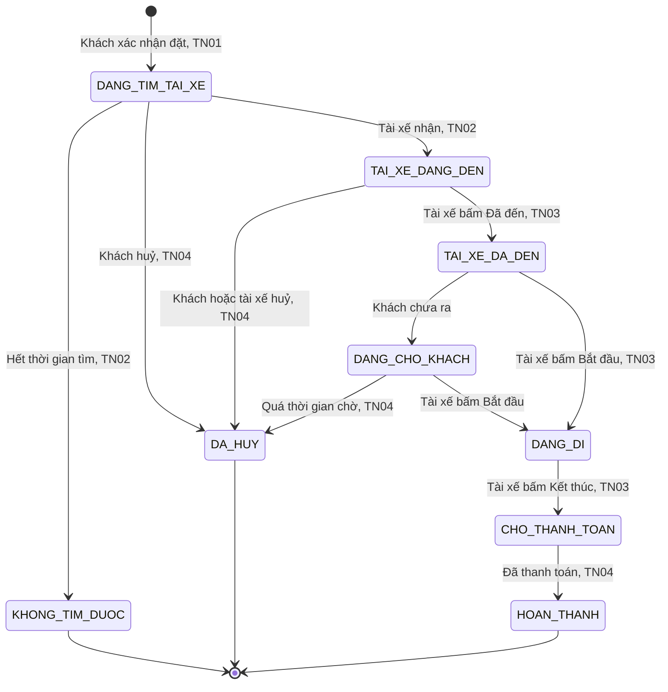
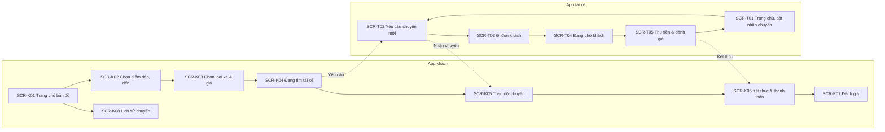

# Đề 4 · Đặt xe công nghệ

> **Mã:** DE04 · **Độ khó:** 4/8 · **Vai trò:** 2 (khách, tài xế) · **Nền tảng:** App khách và App tài xế iOS / Android `[giả định]`

Khách đặt xe máy hoặc ô tô, thấy giá trước khi đặt, theo dõi tài xế trên bản đồ và thanh toán khi kết thúc chuyến. Tài xế nhận yêu cầu, đón khách, hoàn thành chuyến. Đây là đề đầu tiên có **hai phía dùng chung một dữ liệu theo thời gian thực**. Đề gồm 4 tính năng; mỗi tính năng có 1 PRD và 1 SRS riêng.

## Tính năng

| **Mã** | **Tính năng** | **Phạm vi** | **PRD** | **SRS** |
| --- | --- | --- | --- | --- |
| TN01 | Đặt chuyến | Chọn điểm đón, điểm đến, loại xe; xem giá ước tính; xác nhận đặt | [PRD](docs/TN01-dat-chuyen/PRD.md) | [SRS](docs/TN01-dat-chuyen/SRS.md) |
| TN02 | Ghép tài xế & nhận chuyến | Tìm tài xế, gửi yêu cầu, tài xế nhận hoặc bỏ qua, không tìm được tài xế | [PRD](docs/TN02-ghep-tai-xe-nhan-chuyen/PRD.md) | [SRS](docs/TN02-ghep-tai-xe-nhan-chuyen/SRS.md) |
| TN03 | Theo dõi chuyến & an toàn | Vị trí tài xế realtime, trạng thái chuyến hai phía, liên hệ, chia sẻ hành trình, SOS | [PRD](docs/TN03-theo-doi-chuyen-an-toan/PRD.md) | [SRS](docs/TN03-theo-doi-chuyen-an-toan/SRS.md) |
| TN04 | Thanh toán, đánh giá & huỷ chuyến | Tiền mặt hoặc ví, hoá đơn chuyến, đánh giá hai chiều, huỷ và phí huỷ | [PRD](docs/TN04-thanh-toan-danh-gia-huy/PRD.md) | [SRS](docs/TN04-thanh-toan-danh-gia-huy/SRS.md) |

Thứ tự làm gợi ý: TN01 → TN02 → TN03 → TN04.

## Vòng đời chuyến đi (dùng chung cả đề)



## Bản đồ màn hình



## Bối cảnh chung

Khách cần xe nhanh với giá rõ ràng từ trước, và cần cảm thấy an toàn khi đi với người lạ. Tài xế cần nhận chuyến nhanh, biết rõ điểm đón và thu nhập của mỗi chuyến. Bài toán thiết kế chính là giữ hai phía luôn thấy **cùng một trạng thái** khi trạng thái thay đổi liên tục và mạng có thể chập chờn.

| **Nhóm người dùng** | **Nhu cầu chính** |
| --- | --- |
| Khách đi làm hằng ngày | Đặt nhanh, giá ổn định, đến đúng giờ |
| Khách đi đêm, phụ nữ đi một mình | An toàn: biết rõ tài xế, chia sẻ hành trình, SOS |
| Khách lớn tuổi, ít dùng app | Chọn điểm đón dễ, gọi được tài xế |
| Tài xế xe máy, ô tô | Nhận chuyến nhanh, điểm đón chính xác, thu nhập rõ ràng |

Ngoài phạm vi cả đề: đăng ký và duyệt hồ sơ tài xế, đặt xe hẹn giờ, đi chung, giao hàng, khuyến mãi và mã giảm giá, ví điện tử nạp tiền (dùng ví liên kết có sẵn), trang quản trị vận hành, điều phối giá động theo khu vực (chỉ mô tả hệ số cao điểm).

## Quy ước dùng chung

- Màn của App khách có mã `SCR-K..`, App tài xế có mã `SCR-T..`.
- Tiền tệ VND; giá làm tròn tới 1.000 ₫.
- Mã BR, MSG, UC đánh số liên tục trong cả đề: TN01 dùng BR-01–10, MSG-01–08; TN02 dùng BR-11–20, MSG-09–16; TN03 dùng BR-21–31, MSG-17–26; TN04 dùng BR-32–43, MSG-27–38.
- Đăng nhập bằng số điện thoại và OTP theo luồng chuẩn, không mô tả trong bộ tài liệu này.
- Giá trị đánh dấu `[giả định]` dùng để dựng flow, cần PO hoặc BA xác nhận trước khi dùng.

## Danh sách màn hình

| **Mã** | **Màn hình** | **App** | **Mô tả chi tiết ở** |
| --- | --- | --- | --- |
| SCR-K01 | Trang chủ bản đồ | Khách | SRS TN01 |
| SCR-K02 | Chọn điểm đón, điểm đến | Khách | SRS TN01 |
| SCR-K03 | Chọn loại xe & giá | Khách | SRS TN01 |
| SCR-K04 | Đang tìm tài xế | Khách | SRS TN02 |
| SCR-K05 | Theo dõi chuyến | Khách | SRS TN03 |
| SCR-K06 | Kết thúc & thanh toán | Khách | SRS TN04 |
| SCR-K07 | Đánh giá tài xế | Khách | SRS TN04 |
| SCR-K08 | Lịch sử chuyến | Khách | SRS TN04 |
| SCR-T01 | Trang chủ, bật nhận chuyến | Tài xế | SRS TN02 |
| SCR-T02 | Yêu cầu chuyến mới | Tài xế | SRS TN02 |
| SCR-T03 | Đi đón khách | Tài xế | SRS TN03 |
| SCR-T04 | Đang chở khách | Tài xế | SRS TN03 |
| SCR-T05 | Thu tiền & đánh giá khách | Tài xế | SRS TN04 |

## Cấu trúc repo

```text
de04-dat-xe-cong-nghe/
├── README.md
└── docs/
    ├── TN01-dat-chuyen/                 PRD.md · SRS.md
    ├── TN02-ghep-tai-xe-nhan-chuyen/    PRD.md · SRS.md
    ├── TN03-theo-doi-chuyen-an-toan/    PRD.md · SRS.md
    └── TN04-thanh-toan-danh-gia-huy/    PRD.md · SRS.md
```

## Cách dùng bộ tài liệu

1. Đọc README để nắm vòng đời chuyến đi: mọi tính năng đều bám theo sơ đồ trạng thái ở trên.
2. Với mỗi tính năng: đọc PRD, rồi SRS. Luôn thiết kế **cả hai phía**: mỗi trạng thái khách thấy gì, tài xế thấy gì.
3. Thiết kế màn hình theo đúng mã SCR, mã MSG trong SRS để dễ đối chiếu khi review.
4. Sơ đồ viết bằng Mermaid, xem trực tiếp trên GitHub hoặc trình xem Markdown có hỗ trợ Mermaid.
