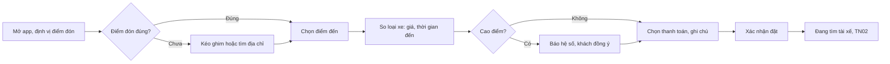

> **Mã:** DE04-TN01-PRD · **Trạng thái:** nháp · **Người viết:** Design (mock) · **SRS:** [SRS.md](SRS.md)

# PRD Đặt chuyến (App đặt xe công nghệ)

> **Bản mock.** Con số đánh dấu `[giả định]` dùng để dựng flow, cần PO xác nhận trước khi dùng.

## 1. Bối cảnh và vấn đề

### 1.1 Bối cảnh

Đặt chuyến là bước đầu tiên trong vòng đời chuyến đi (xem [README](../../README.md)). Khách thường đặt xe khi đang vội, đứng ngoài đường, một tay cầm điện thoại. Hai thông tin quyết định khách có đặt hay không là điểm đón có chính xác không và giá bao nhiêu.

### 1.2 Vấn đề

| **Vấn đề** | **Hệ quả** |
| --- | --- |
| Định vị lệch vài chục mét, nhất là trong hẻm, toà nhà | Tài xế đến sai chỗ, hai bên gọi nhau mất thời gian |
| Gõ địa chỉ tiếng Việt khó, gợi ý không đúng | Chọn nhầm điểm đến, giá sai |
| Giá chỉ biết sau chuyến | Khách lo bị tính quá, ngại đặt |
| Không so được các loại xe | Chọn loại không phù hợp |
| Giá cao điểm tăng mà không báo | Khách thấy bị lừa, đánh giá thấp |

### 1.3 Mục tiêu

- Từ mở app tới xác nhận đặt ≤ 30 giây với địa chỉ quen `[giả định]`.
- Tỉ lệ chuyến bị gọi điện vì sai điểm đón ≤ 10% `[giả định]`.
- Chênh lệch giữa giá ước tính và giá cuối ≤ 10% ở ≥ 90% chuyến `[giả định]`.

## 2. Người dùng

| **Nhóm** | **Nhu cầu với tính năng này** |
| --- | --- |
| Khách đi làm hằng ngày | Chọn nhanh địa chỉ nhà, công ty đã lưu |
| Khách đi đêm | Biết giá trước, chọn điểm đón sáng, dễ thấy |
| Khách lớn tuổi | Kéo ghim trên bản đồ thay vì gõ địa chỉ |

## 3. Phạm vi

### 3.1 Trong phạm vi (MVP)

- Tự định vị điểm đón; chỉnh bằng kéo ghim hoặc tìm địa chỉ.
- Tìm điểm đến: gợi ý địa chỉ, địa điểm đã lưu (Nhà, Công ty), chuyến gần đây.
- Loại xe: Xe máy, Ô tô 4 chỗ, Ô tô 7 chỗ.
- Giá ước tính theo từng loại xe, thời gian đến dự kiến, thông báo cao điểm.
- Ghi chú cho tài xế (ví dụ "cổng sau").
- Chọn phương thức thanh toán trước khi đặt (chi tiết ở [TN04](../TN04-thanh-toan-danh-gia-huy/PRD.md)).

### 3.2 Ngoài phạm vi

- Đặt xe hẹn giờ, đặt nhiều điểm dừng → phase sau.
- Đặt hộ người khác.
- Mã giảm giá.
- Giá cố định trọn gói cho chặng sân bay.

## 4. Nguyên tắc sản phẩm

### 4.1 Điểm đón là thứ quan trọng nhất

Điểm đón luôn hiện trên bản đồ với ghim lớn và tên dễ hiểu. Kéo ghim được ngay tại màn chính.

### 4.2 Biết giá trước khi đặt

Mỗi loại xe hiện giá ước tính trước khi khách bấm đặt. Giá cuối chỉ khác khi lộ trình thay đổi.

### 4.3 Nói thật về cao điểm

Giá cao điểm được ghi rõ, kèm hệ số, trước khi khách bấm đặt. Không tăng giá sau khi khách đã xác nhận.

### 4.4 Ít gõ nhất có thể

Địa điểm đã lưu, chuyến gần đây và gợi ý theo từ khoá giúp khách hầu như không phải gõ đầy đủ địa chỉ.

## 5. Quy tắc nghiệp vụ

| **Quy tắc** | **Giá trị** `[giả định]` |
| --- | --- |
| Loại xe | Xe máy, Ô tô 4 chỗ, Ô tô 7 chỗ |
| Công thức giá | Giá mở cửa + giá mỗi km × km + giá mỗi phút × phút, nhân hệ số cao điểm, làm tròn 1.000 ₫ |
| Giá tối thiểu | Xe máy 12.000 ₫, Ô tô 4 chỗ 25.000 ₫, Ô tô 7 chỗ 32.000 ₫ |
| Hệ số cao điểm | 1,0 đến 2,0; hiện khi > 1,0 |
| Hiệu lực giá ước tính | 5 phút; quá thì tính lại |
| Khoảng cách | Điểm đến cách điểm đón 300 m đến 100 km |
| Vùng phục vụ | Điểm đón và điểm đến trong vùng phục vụ |
| Địa điểm đã lưu | Nhà, Công ty và tối đa 10 địa điểm khác |

- Các giá trị trên là **cấu hình theo thành phố**, không cố định trong code.

## 6. Luồng trải nghiệm

| **Bước** | **Giai đoạn** | **Trải nghiệm** | **Đầu ra** |
| --- | --- | --- | --- |
| 1 | Mở app | Bản đồ định vị điểm đón; ghim kèm tên địa điểm | Điểm đón đề xuất |
| 2 | Chỉnh điểm đón | Kéo ghim; hoặc chạm ô điểm đón để tìm | Điểm đón chính xác |
| 3 | Chọn điểm đến | Ô "Bạn muốn đi đâu?"; Nhà, Công ty, gần đây, gợi ý | Điểm đến |
| 4 | Chọn loại xe | Danh sách loại xe với giá ước tính, thời gian tài xế đến | Loại xe |
| 5 | Xác nhận | Phương thức thanh toán, ghi chú cho tài xế, nút "Đặt {loại xe}" | Chuyến được tạo |

## 7. Use Cases, User Stories và Acceptance Criteria

### UC1. Chọn điểm đón và điểm đến

#### US1.1 Chọn điểm đón chính xác

User Story: Là khách, tôi muốn điểm đón chính xác để tài xế tìm thấy tôi ngay.

AC01: Mở app tự định vị; điểm đón hiện ghim lớn và tên địa điểm gần nhất.

AC02: Kéo bản đồ để dời ghim; thả tay thì tên điểm đón cập nhật.

AC03: Độ chính xác định vị kém → nhắc khách kiểm tra lại ghim.

AC04: Chưa cấp quyền vị trí → hỏi quyền kèm lý do; từ chối thì khách tự tìm điểm đón.

AC05: Điểm đón ngoài vùng phục vụ → báo rõ, không cho tiếp tục.

#### US1.2 Chọn điểm đến

User Story: Là khách, tôi muốn chọn điểm đến nhanh từ địa điểm đã lưu hoặc gần đây để đặt xe trong vài giây.

AC01: Ô tìm kiếm gợi ý địa chỉ khi gõ, chấp nhận gõ không dấu.

AC02: Hiện Nhà, Công ty (nếu đã lưu) và 5 điểm đến gần đây ngay khi mở ô tìm.

AC03: Chọn được điểm đến bằng ghim trên bản đồ.

AC04: Điểm đến quá gần (< 300 m) hoặc quá xa (> 100 km) → báo rõ.

### UC2. Chọn loại xe và xem giá

#### US2.1 So sánh loại xe

User Story: Là khách, tôi muốn thấy giá và thời gian đến của từng loại xe để chọn loại phù hợp.

AC01: Mỗi loại xe hiện giá ước tính, số chỗ, thời gian tài xế đến dự kiến.

AC02: Loại xe không có tài xế gần → hiện "Không có xe gần bạn", không chọn được.

AC03: Lộ trình hiện trên bản đồ, kèm quãng đường và thời gian đi.

#### US2.2 Biết về cao điểm

User Story: Là khách, tôi muốn được báo rõ khi giá đang cao điểm để không bất ngờ về giá.

AC01: Hệ số > 1,0 → nhãn "Cao điểm ×{hệ số}" cạnh giá và giải thích khi chạm.

AC02: Lần đầu gặp cao điểm trong phiên → khách phải bấm đồng ý trước khi đặt.

#### US2.3 Xác nhận đặt chuyến

User Story: Là khách, tôi muốn xem lại phương thức thanh toán và ghi chú cho tài xế trước khi đặt để tài xế đón đúng chỗ.

AC01: Hiện phương thức thanh toán đang chọn, đổi được trước khi đặt.

AC02: Ghi chú cho tài xế tuỳ chọn, tối đa 100 ký tự.

AC03: Giá ước tính quá 5 phút → tính lại; giá thay đổi thì báo khách trước khi đặt.

AC04: Bấm "Đặt" chỉ tạo một chuyến dù bấm nhiều lần.

### UC3. Địa điểm đã lưu

AC01: Lưu Nhà, Công ty và tối đa 10 địa điểm khác từ ô tìm kiếm hoặc chuyến gần đây.

AC02: Sửa, xoá địa điểm đã lưu trong Hồ sơ.

## 8. Chỉ số theo dõi `[giả định]`

| **Chỉ số** | **Định nghĩa** | **Mục tiêu MVP** |
| --- | --- | --- |
| Tỉ lệ chuyển đổi đặt | Chuyến được đặt / phiên mở màn chọn loại xe | ≥ 50% |
| Thời gian đặt | Từ mở app tới xác nhận đặt | ≤ 30 giây (trung vị) |
| Tỉ lệ chỉnh điểm đón | Phiên có kéo ghim / phiên đặt | Theo dõi; cao là dấu hiệu định vị kém |
| Sai lệch giá | Giá cuối so với giá ước tính | ≤ 10% ở ≥ 90% chuyến |
| Tỉ lệ bỏ khi cao điểm | Phiên bỏ sau khi thấy cao điểm / phiên gặp cao điểm | Theo dõi |
| Tỉ lệ dùng địa điểm đã lưu | Điểm đến chọn từ đã lưu, gần đây / tổng chuyến | ≥ 40% |

## 9. Phụ thuộc và rủi ro

| **Mục** | **Mô tả** | **Hướng xử lý** |
| --- | --- | --- |
| Dịch vụ bản đồ, tìm địa chỉ | Phụ thuộc nhà cung cấp; dữ liệu hẻm, ngõ kém | Cho kéo ghim; ghi chú cho tài xế |
| Định vị trong nhà | GPS lệch | Nhắc kiểm tra ghim khi độ chính xác kém |
| Giá cao điểm | Dễ gây phản ứng | Báo rõ trước khi đặt, cần đồng ý |
| Bấm đặt nhiều lần | Tạo chuyến trùng | Idempotency key cho mỗi lần đặt |

## 10. Câu hỏi mở

> Mọi câu hỏi dưới đây đã được PO chốt ngày 13/11/2026; quyết định ghi sau mỗi câu và đã cập nhật vào SRS.

- Có cho đặt khi điểm đón ngoài vùng nhưng điểm đến trong vùng? → **Đã chốt:** Không. Cả điểm đón và điểm đến phải trong vùng phục vụ (SRS BR-02).
- Hệ số cao điểm tối đa là bao nhiêu, ai quyết định? → **Đã chốt:** Hệ thống tự tính từ dữ liệu giao thông Google Maps, trần ×2,0 (SRS BR-07).
- Có gợi ý điểm đón chuẩn (cổng chính, sảnh) cho toà nhà lớn? → **Đã chốt:** Có, tối đa 3 điểm chuẩn (SRS BR-44).
- Giá ước tính có hiển thị dạng khoảng (từ–đến) thay vì một con số? → **Đã chốt:** Không. Hiện một con số (SRS BR-05).
