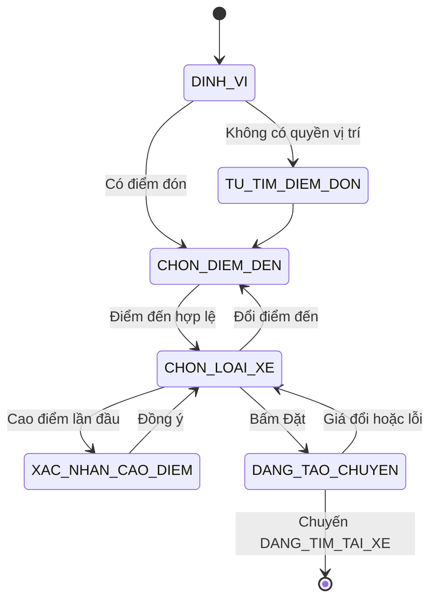
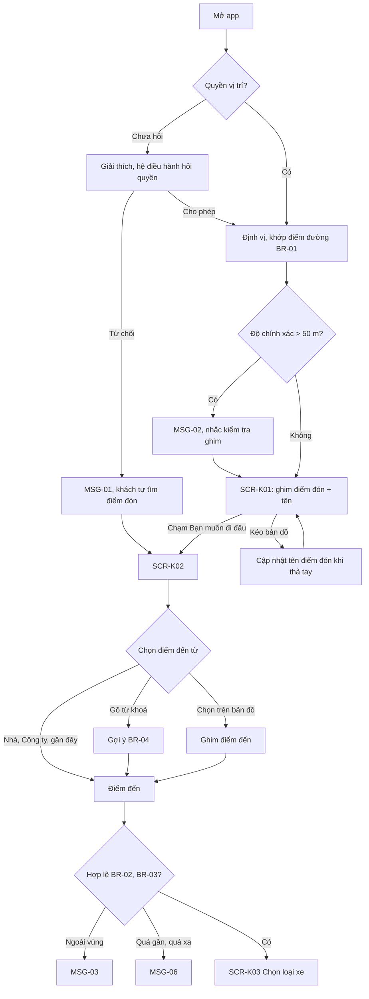
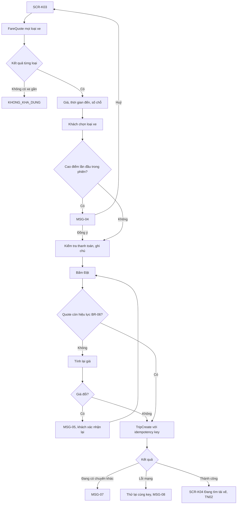
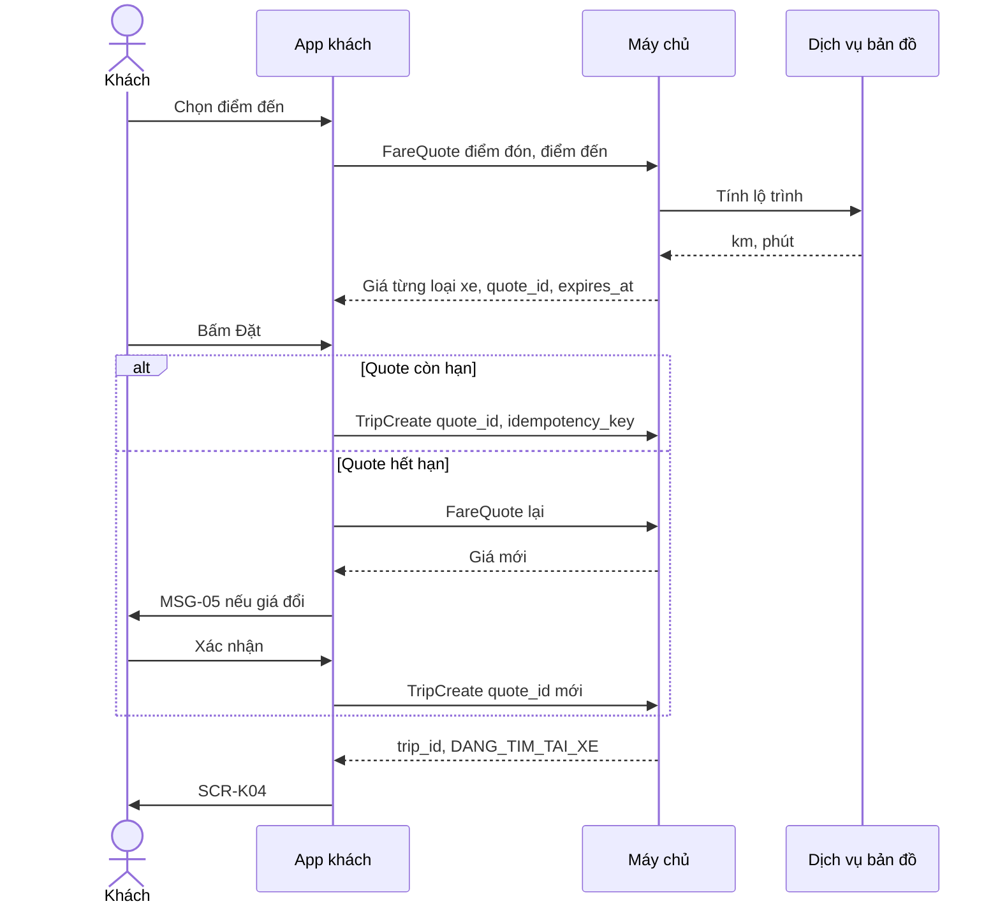

> **Mã:** DE04-TN01-SRS · **Trạng thái:** nháp · **Người viết:** Design (mock) · **PRD:** [PRD.md](PRD.md)

# UC-DE04-01 - Đặt chuyến

> **Bản mock.** Giá trị `[giả định]` cần BA xác nhận. SRS này mô tả từ lúc mở app đến khi chuyến được tạo ở trạng thái `DANG_TIM_TAI_XE`; ghép tài xế xem [SRS TN02](../TN02-ghep-tai-xe-nhan-chuyen/SRS.md).

## 1. Tổng quan

| **Mục** | **Nội dung** |
| --- | --- |
| Mục tiêu | Khách chọn điểm đón, điểm đến, loại xe, xem giá ước tính và tạo chuyến |
| Actor | Khách · App khách · Máy chủ · Dịch vụ bản đồ |
| Phạm vi | Định vị, chọn điểm đón và điểm đến, địa điểm đã lưu, loại xe, giá ước tính, cao điểm, xác nhận đặt |
| Ngoài phạm vi | Hẹn giờ, nhiều điểm dừng, đặt hộ, mã giảm giá |
| Nền tảng | App khách iOS / Android `[giả định]` |
| Figma | `[chưa có]` |

## 2. User Story

| **ID** | **As a** | **I want** | **So that** |
| --- | --- | --- | --- |
| US-01 | Khách | Điểm đón tự định vị và chỉnh được bằng kéo ghim | Tài xế tìm thấy tôi ngay |
| US-02 | Khách | Chọn điểm đến nhanh từ địa điểm đã lưu | Đặt xe trong vài giây |
| US-03 | Khách | Thấy giá và thời gian đến của từng loại xe | Chọn loại phù hợp |
| US-04 | Khách | Được báo rõ khi giá cao điểm | Không bất ngờ về giá |
| US-05 | Khách | Ghi chú cho tài xế | Tài xế đón đúng chỗ |

## 3. Business Rules

| **Mã** | **Quy tắc** |
| --- | --- |
| BR-01 | **Điểm đón mặc định** = vị trí thiết bị, khớp vào điểm đường gần nhất mà xe dừng được. Độ chính xác định vị > 50 m → hiện MSG-02 `[giả định]` |
| BR-02 | **Vùng phục vụ**: điểm đón và điểm đến phải nằm trong vùng phục vụ của thành phố; ngoài vùng → MSG-03, không cho sang bước chọn loại xe |
| BR-03 | **Khoảng cách** điểm đón tới điểm đến từ 300 m đến 100 km theo đường đi `[giả định]` |
| BR-04 | **Gợi ý điểm đến**: khi mở ô tìm hiện Nhà, Công ty, địa điểm đã lưu, 5 điểm đến gần nhất; khi gõ ≥ 2 ký tự gọi tìm địa chỉ, chấp nhận không dấu, chờ 300 ms sau lần gõ cuối |
| BR-05 | **Giá ước tính** = max(giá tối thiểu, giá mở cửa + đơn giá km × km + đơn giá phút × phút) × hệ số cao điểm, làm tròn lên 1.000 ₫. Đơn giá theo loại xe và thành phố `[giả định]` |
| BR-06 | **Hiệu lực giá** 5 phút kể từ lúc tính (quote_id). Quá hạn khi bấm Đặt → tính lại; giá mới khác giá cũ → MSG-05 trước khi tạo chuyến |
| BR-07 | **Cao điểm**: hệ số > 1,0 thì nhãn "Cao điểm ×{hệ số}"; lần đầu mỗi phiên phải đồng ý (MSG-04). Giá sau khi khách đã đặt không đổi vì cao điểm |
| BR-08 | **Loại xe không khả dụng** khi không có tài xế đang rảnh trong bán kính 5 km `[giả định]`; hiện "Không có xe gần bạn", disabled |
| BR-09 | **Tạo chuyến** dùng idempotency key cho mỗi lần xác nhận; bấm nhiều lần chỉ tạo 1 chuyến. Khách đang có chuyến chưa kết thúc thì không đặt thêm được (MSG-07) |
| BR-10 | **Ghi chú cho tài xế** tối đa 100 ký tự. **Địa điểm đã lưu**: Nhà, Công ty và tối đa 10 địa điểm khác, tên 1–30 ký tự |

## 4. Trạng thái

### 4.1 Các bước của luồng đặt

### 4.2 Trạng thái loại xe trên SCR-K03

| **Trạng thái** | **Điều kiện** | **Hiển thị** |
| --- | --- | --- |
| `KHA_DUNG` | Có tài xế rảnh gần, có giá | Giá, "{n} phút", số chỗ; chọn được |
| `CAO_DIEM` | Khả dụng, hệ số > 1,0 | Như trên + nhãn "Cao điểm ×{hệ số}" |
| `KHONG_KHA_DUNG` | BR-08 | Mờ, "Không có xe gần bạn" |
| `DANG_TINH_GIA` | Đang gọi \[FareQuote\] | Skeleton ở ô giá |

## 5. Use Case

### UC-01 Chọn điểm đón và điểm đến

| **Mục** | **Nội dung** |
| --- | --- |
| Tiền điều kiện | Khách đã đăng nhập, không có chuyến đang diễn ra |
| Hậu điều kiện thành công | Có điểm đón và điểm đến hợp lệ; mở **SCR-K03** |
| Hậu điều kiện thất bại | Ở lại **SCR-K01** hoặc **SCR-K02** với thông báo lỗi |

**Luồng chính**

| **Bước** | **Actor** | **Mô tả** |
| --- | --- | --- |
| 1 | Khách | Mở app |
| 2 | App | Định vị, khớp điểm đón (BR-01), hiện **SCR-K01** với ghim và tên điểm đón |
| 3 | Khách | Chạm "Bạn muốn đi đâu?" |
| 4 | App | Mở **SCR-K02**, hiện gợi ý theo BR-04 |
| 5 | Khách | Chọn điểm đến |
| 6 | App | Kiểm tra BR-02, BR-03; hợp lệ → mở **SCR-K03** |

**Luồng thay thế**

| **Mã** | **Điều kiện** | **Xử lý** |
| --- | --- | --- |
| A1 | Kéo ghim điểm đón | Thả tay → cập nhật tên (\[ReverseGeocode\]) |
| A2 | Chạm ô điểm đón ở **SCR-K02** | Tìm điểm đón như tìm điểm đến |
| A3 | Từ chối quyền vị trí | MSG-01; ô điểm đón trống, khách tự tìm |
| A4 | Chọn "Chọn trên bản đồ" | Ghim điểm đến ở giữa màn, kéo bản đồ để đặt |
| A5 | Lưu địa điểm | Biểu tượng ngôi sao cạnh gợi ý → đặt tên, lưu (BR-10) |

**Luồng lỗi**

| **Mã** | **Điều kiện** | **Xử lý** |
| --- | --- | --- |
| E1 | Ngoài vùng phục vụ | MSG-03 |
| E2 | Khoảng cách không hợp lệ | MSG-06 |
| E3 | Dịch vụ tìm địa chỉ lỗi | MSG-08; vẫn cho chọn trên bản đồ |

### UC-02 Chọn loại xe và xác nhận đặt

| **Mục** | **Nội dung** |
| --- | --- |
| Tiền điều kiện | Có điểm đón, điểm đến hợp lệ |
| Hậu điều kiện thành công | Chuyến được tạo ở `DANG_TIM_TAI_XE` với giá đã chốt; mở **SCR-K04** |
| Hậu điều kiện thất bại | Không tạo chuyến; ở lại **SCR-K03** |

**Luồng chính**

| **Bước** | **Actor** | **Mô tả** |
| --- | --- | --- |
| 1 | App | Gọi \[FareQuote\] cho mọi loại xe; hiện **SCR-K03** với lộ trình, giá, thời gian đến |
| 2 | Khách | Chọn loại xe |
| 3 | Khách | Kiểm tra phương thức thanh toán; thêm ghi chú cho tài xế (tuỳ chọn) |
| 4 | Khách | Bấm "Đặt {loại xe}" |
| 5 | App | Kiểm tra BR-06; gọi \[TripCreate\] với quote_id và idempotency key; nút chuyển loading |
| 6 | Máy chủ | Tạo chuyến `DANG_TIM_TAI_XE`, chốt giá ước tính |
| 7 | App | Mở **SCR-K04** |

**Luồng thay thế**

| **Mã** | **Điều kiện** | **Xử lý** |
| --- | --- | --- |
| A1 | Cao điểm lần đầu | MSG-04 trước bước 4 (BR-07) |
| A2 | Quote hết hạn, giá đổi | MSG-05 (BR-06) |
| A3 | Đổi phương thức thanh toán | Mở chọn phương thức (SRS TN04) |
| A4 | Ví liên kết lỗi hoặc không đủ số dư | Gợi ý chuyển sang tiền mặt (SRS TN04) |
| A5 | Mọi loại xe `KHONG_KHA_DUNG` | MSG-09 ở **SCR-K03**, nút Đặt disabled |

**Luồng lỗi**

| **Mã** | **Điều kiện** | **Xử lý** |
| --- | --- | --- |
| E1 | Đang có chuyến khác | MSG-07, nút "Xem chuyến hiện tại" |
| E2 | Lỗi mạng khi tạo chuyến | Gửi lại cùng idempotency key; vẫn lỗi → MSG-08 |
| E3 | \[FareQuote\] lỗi | Ô giá hiện "Chưa tính được giá" + Thử lại; nút Đặt disabled |

## 6. Điểm vào

| **Điểm vào** | **Dẫn tới** | **Ghi chú** |
| --- | --- | --- |
| Mở app | UC-01, **SCR-K01** | Có chuyến đang diễn ra → mở thẳng **SCR-K05** |
| Chạm Nhà, Công ty ở **SCR-K01** | UC-01, nhảy thẳng **SCR-K03** | |
| "Đặt lại" ở chuyến trong **SCR-K08** | UC-02 với điểm đón, đến cũ | SRS TN04 |
| Không tìm được tài xế → "Đặt lại" | UC-02 | SRS TN02 |

## 7. Mô tả màn hình

### SCR-K01 Trang chủ bản đồ

| **#** | **Thành phần** | **Loại** | **Hành vi** |
| --- | --- | --- | --- |
| 1 | Bản đồ | Map | Ghim điểm đón cố định giữa màn; kéo bản đồ để dời |
| 2 | Nhãn điểm đón | Tooltip | Tên điểm đón; "Đang xác định…" khi đang tìm tên |
| 3 | Nút về vị trí của tôi | Icon | Đưa bản đồ về vị trí thiết bị |
| 4 | Ô "Bạn muốn đi đâu?" | Search bar | Mở **SCR-K02** |
| 5 | Lối tắt | Chips | Nhà, Công ty (nếu có), 2 điểm đến gần nhất |
| 6 | Cảnh báo định vị | Banner | MSG-02 |

### SCR-K02 Chọn điểm đón, điểm đến

| **#** | **Thành phần** | **Loại** | **Bắt buộc** | **Validate / hành vi** |
| --- | --- | --- | --- | --- |
| 1 | Điểm đón | Text | Có | Điền sẵn; chạm để tìm |
| 2 | Điểm đến | Text | Có | Focus sẵn; gõ ≥ 2 ký tự để gợi ý (BR-04) |
| 3 | Đã lưu & gần đây | List | – | Nhà, Công ty, đã lưu, 5 gần đây |
| 4 | Gợi ý địa chỉ | List | – | Tên, địa chỉ, khoảng cách; ngôi sao để lưu |
| 5 | "Chọn trên bản đồ" | Button | – | A4 |

### SCR-K03 Chọn loại xe & giá

| **#** | **Thành phần** | **Loại** | **Hành vi** |
| --- | --- | --- | --- |
| 1 | Bản đồ lộ trình | Map | Đường đi, điểm đón, điểm đến; "{km} km · {phút} phút" |
| 2 | Danh sách loại xe | Radio list | Mỗi loại: biểu tượng, tên, số chỗ, "{n} phút", giá ước tính; trạng thái theo mục 4.2 |
| 3 | Nhãn cao điểm | Tag | "Cao điểm ×{hệ số}", chạm xem giải thích |
| 4 | Phương thức thanh toán | Dòng chọn | Tiền mặt hoặc ví liên kết (SRS TN04) |
| 5 | Ghi chú cho tài xế | Dòng nhập | BR-10; placeholder "Ví dụ: đứng ở cổng sau" |
| 6 | Nút "Đặt {loại xe}" | Button | Disabled khi chưa chọn loại hoặc chưa có giá; loading khi đang tạo |
| 7 | Ghi chú giá | Text phụ | "Giá ước tính, có thể thay đổi nếu đổi lộ trình" |

## 8. API

| **API** | **Request chính** | **Response chính** | **Timeout / retry** `[giả định]` |
| --- | --- | --- | --- |
| \[ReverseGeocode\] | lat, lng | Tên điểm, địa chỉ, điểm đường đã khớp | 3s / 1 lần |
| \[PlaceSearch\] | keyword, vị trí hiện tại | Danh sách gợi ý | 3s / không retry |
| \[ServiceAreaCheck\] | lat, lng | in_area | 3s / 1 lần |
| \[FareQuote\] | pickup, dropoff | Từng loại xe: quote_id, giá, hệ số, thời gian đến, khả dụng; lộ trình, km, phút; expires_at | 5s / 1 lần |
| \[TripCreate\] | quote_id, vehicle_type, pickup, dropoff, note, payment_method, idempotency_key | trip_id, trạng thái `DANG_TIM_TAI_XE`, giá chốt | 8s / gửi lại cùng key |
| \[SavedPlaceSave\] | name, lat, lng, type (HOME, WORK, OTHER) | place_id | 5s / 1 lần |

## 9. Danh sách thông báo

| **ID** | **Nơi hiện** | **Nội dung (VI)** |
| --- | --- | --- |
| MSG-01 | Banner | Bật vị trí để app tìm điểm đón cho bạn, hoặc nhập điểm đón bên dưới. \[Bật vị trí\] |
| MSG-02 | Banner **SCR-K01** | Vị trí chưa chính xác. Kiểm tra lại ghim điểm đón nhé |
| MSG-03 | Inline | Địa điểm này nằm ngoài khu vực phục vụ |
| MSG-04 | Popup | Đang cao điểm, giá cao hơn bình thường ×{hệ số}. Giá ước tính: {giá} ₫. \[Đồng ý\] \[Để sau\] |
| MSG-05 | Popup | Giá đã cập nhật thành {giá mới} ₫. \[Đặt với giá mới\] \[Huỷ\] |
| MSG-06 | Inline | Điểm đến cần cách điểm đón từ 300 m đến 100 km |
| MSG-07 | Popup | Bạn đang có một chuyến chưa kết thúc. \[Xem chuyến hiện tại\] |
| MSG-08 | Toast | Kết nối không ổn định, vui lòng thử lại |
| MSG-09 | Inline **SCR-K03** | Hiện không có xe gần bạn. Vui lòng thử lại sau ít phút |

Bản EN: `[chờ bổ sung]`.

## 10. Yêu cầu phi chức năng

| **Mục** | **Yêu cầu** `[giả định]` |
| --- | --- |
| Hiệu năng | Định vị và hiện tên điểm đón ≤ 3 giây; \[FareQuote\] ≤ 2 giây (p95); gợi ý địa chỉ ≤ 1 giây |
| Độ chính xác | Giá cuối lệch giá ước tính ≤ 10% khi đi đúng lộ trình đề xuất |
| Bảo mật, riêng tư | Vị trí chỉ lấy khi app đang dùng; địa điểm đã lưu chỉ người dùng thấy |
| Log / audit | Mỗi quote: quote_id, đơn giá, hệ số, thời điểm; mỗi chuyến: quote_id đã dùng |
| Tracking | Mở app, kéo ghim, chọn điểm đến (nguồn), xem loại xe, gặp cao điểm, đồng ý, đặt, lỗi |
| Accessibility | Ghim và nút có nhãn đọc màn hình; có cách chọn điểm đón không cần kéo bản đồ (tìm địa chỉ); giá đọc được đầy đủ |
