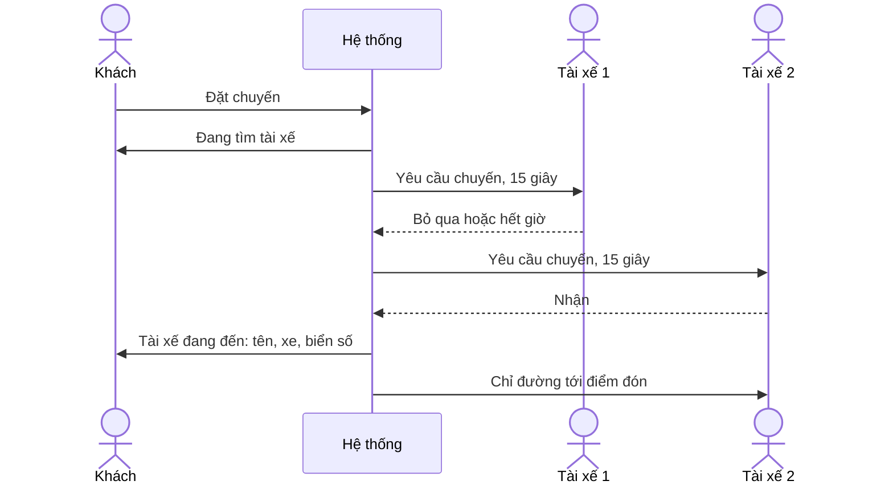

> **Mã:** DE04-TN02-PRD · **Trạng thái:** nháp · **Người viết:** Design (mock) · **SRS:** [SRS.md](SRS.md)

# PRD Ghép tài xế và nhận chuyến (App đặt xe công nghệ)

> **Bản mock.** Con số đánh dấu `[giả định]` dùng để dựng flow, cần PO xác nhận trước khi dùng.

## 1. Bối cảnh và vấn đề

### 1.1 Bối cảnh

Sau khi khách đặt ([TN01](../TN01-dat-chuyen/PRD.md)), hệ thống phải tìm một tài xế phù hợp và tài xế phải quyết định nhận hay bỏ qua trong vài giây. Đây là lúc hai phía của sản phẩm gặp nhau: khách chờ và lo lắng, tài xế đang lái xe và cần quyết định nhanh.

### 1.2 Vấn đề

| **Vấn đề** | **Hệ quả** |
| --- | --- |
| Khách chờ mà không biết hệ thống đang làm gì | Huỷ sớm, đặt lại liên tục |
| Tài xế thiếu thông tin để quyết định | Nhận rồi huỷ, hoặc bỏ qua chuyến tốt |
| Yêu cầu hiện lúc tài xế đang lái | Mất an toàn, bấm nhầm |
| Gửi cùng lúc cho nhiều tài xế | Nhiều người bấm nhận, chỉ một người được, số còn lại bực bội |
| Không tìm được tài xế mà không có gợi ý | Khách bỏ đi |

### 1.3 Mục tiêu

- ≥ 85% chuyến tìm được tài xế trong 2 phút `[giả định]`.
- Thời gian ghép trung vị ≤ 30 giây `[giả định]`.
- Tỉ lệ tài xế huỷ sau khi nhận ≤ 5% `[giả định]`.

## 2. Người dùng

| **Nhóm** | **Nhu cầu với tính năng này** |
| --- | --- |
| Khách đang vội | Biết đang tìm, đã tìm được chưa, ai sẽ đến |
| Tài xế xe máy | Thấy điểm đón, điểm đến, thu nhập trước khi nhận; nhận bằng một chạm |
| Tài xế ô tô | Tránh chuyến quá xa điểm đón |

## 3. Phạm vi

### 3.1 Trong phạm vi (MVP)

- Tài xế bật, tắt trạng thái nhận chuyến.
- Hệ thống gửi yêu cầu lần lượt cho từng tài xế phù hợp nhất (mỗi lần một người).
- Tài xế có 15 giây để nhận hoặc bỏ qua; xem điểm đón, điểm đến, khoảng cách tới điểm đón, thu nhập dự kiến.
- Khách thấy trạng thái đang tìm, bán kính tìm, và thông tin tài xế khi ghép xong.
- Không tìm được tài xế sau 3 phút: gợi ý loại xe khác hoặc đặt lại.

### 3.2 Ngoài phạm vi

- Tài xế chọn chuyến từ danh sách chờ.
- Ghép nối tiếp (nhận chuyến tiếp theo khi đang chở khách) → phase sau.
- Tài xế yêu thích của khách.
- Điều phối theo đơn giá động.

## 4. Nguyên tắc sản phẩm

### 4.1 Mỗi yêu cầu một tài xế

Một yêu cầu chỉ gửi cho một tài xế mỗi lần, để ai bấm nhận cũng được chuyến. Không có tình huống tranh nhau.

### 4.2 Đủ thông tin để quyết định trong 15 giây

Tài xế thấy những gì cần để quyết định: bao xa tới điểm đón, đi đâu, được bao nhiêu tiền. Không cần đọc chữ nhỏ.

### 4.3 Khách luôn biết đang ở bước nào

Màn chờ có chuyển động và chữ "Đang tìm tài xế gần bạn". Ghép xong là thấy ngay tên, ảnh, biển số, xe, đánh giá.

### 4.4 An toàn khi đang lái

Yêu cầu có âm thanh rõ, nút nhận to, và bỏ qua tự động khi hết giờ. Bỏ qua không bị phạt nặng.

## 5. Quy tắc nghiệp vụ

| **Quy tắc** | **Giá trị** `[giả định]` |
| --- | --- |
| Bán kính tìm | Bắt đầu 2 km, mở rộng 1 km mỗi 30 giây, tối đa 5 km |
| Chọn tài xế | Đang rảnh, đúng loại xe, gần nhất theo thời gian đi tới điểm đón |
| Thời gian trả lời | 15 giây; hết giờ tính là bỏ qua |
| Gửi lại | Không gửi lại cho tài xế đã bỏ qua chuyến này |
| Thời gian tìm tối đa | 3 phút |
| Tỉ lệ nhận | Theo dõi theo tài xế, không khoá tài khoản ở MVP |
| Tài xế huỷ sau khi nhận | Tìm lại tài xế khác cho khách, ưu tiên khách trong hàng đợi |
| Thu nhập dự kiến | Giá chốt của chuyến trừ chiết khấu nền tảng |

- Các giá trị trên là **cấu hình theo thành phố**, không cố định trong code.

## 6. Luồng trải nghiệm

| **Bước** | **Giai đoạn** | **Trải nghiệm khách** | **Trải nghiệm tài xế** |
| --- | --- | --- | --- |
| 1 | Bật nhận chuyến | – | Bật công tắc "Nhận chuyến" ở trang chủ |
| 2 | Đang tìm | Màn chờ, bán kính tìm mở rộng dần, nút Huỷ | – |
| 3 | Gửi yêu cầu | – | Thẻ yêu cầu toàn màn, âm thanh, đếm ngược 15 giây |
| 4 | Quyết định | – | Nhận hoặc Bỏ qua |
| 5 | Ghép xong | Thông tin tài xế, thời gian đến | Chỉ đường tới điểm đón |
| 6 | Không tìm được | Gợi ý loại xe khác, đặt lại | – |

## 7. Use Cases, User Stories và Acceptance Criteria

### UC1. Tài xế sẵn sàng nhận chuyến

#### US1.1 Bật, tắt nhận chuyến

User Story: Là tài xế, tôi muốn bật, tắt nhận chuyến để chỉ nhận yêu cầu khi tôi sẵn sàng.

AC01: Công tắc "Nhận chuyến" ở trang chủ; bật thì hiện "Đang chờ chuyến" và chia sẻ vị trí.

AC02: Chưa cấp quyền vị trí luôn bật → không bật được nhận chuyến, có hướng dẫn.

AC03: Tắt nhận chuyến khi đang có yêu cầu → yêu cầu đó tính là bỏ qua.

### UC2. Tài xế nhận yêu cầu

#### US2.1 Xem yêu cầu và quyết định

User Story: Là tài xế, tôi muốn thấy đủ thông tin chuyến để quyết định nhận hay không trong vài giây.

AC01: Thẻ yêu cầu hiện: loại xe, khoảng cách và thời gian tới điểm đón, tên điểm đón, điểm đến, quãng đường chuyến, thu nhập dự kiến, phương thức thanh toán, đánh giá của khách.

AC02: Âm thanh và rung khi có yêu cầu, kể cả khi app đang ở nền.

AC03: Đếm ngược 15 giây hiện rõ; hết giờ tự đóng và tính là bỏ qua.

AC04: Nút "Nhận" chiếm phần lớn chiều rộng; "Bỏ qua" là nút phụ.

AC05: Bấm Nhận khi chuyến vừa bị khách huỷ → báo chuyến không còn.

### UC3. Khách chờ ghép tài xế

#### US3.1 Theo dõi việc tìm tài xế

User Story: Là khách, tôi muốn biết hệ thống đang tìm tài xế cho tôi để không phải đặt lại.

AC01: Màn chờ có hiệu ứng tìm kiếm, chữ "Đang tìm tài xế gần bạn", thời gian đã chờ.

AC02: Sau 60 giây hiện "Đang mở rộng khu vực tìm".

AC03: Có nút Huỷ chuyến; huỷ lúc đang tìm không mất phí (TN04).

#### US3.2 Nhận thông tin tài xế

User Story: Là khách, tôi muốn thấy ngay tài xế nào sẽ đến để nhận ra xe khi tới.

AC01: Ghép xong → hiện ảnh, tên, đánh giá, hãng và màu xe, biển số (to, dễ đọc), thời gian đến.

AC02: Thông báo đẩy khi app ở nền.

#### US3.3 Không tìm được tài xế

User Story: Là khách, tôi muốn được gợi ý khi không tìm được tài xế để vẫn có cách đi.

AC01: Sau 3 phút không ghép được → báo rõ, chuyến kết thúc, không mất phí.

AC02: Gợi ý loại xe khác đang có tài xế gần, kèm giá; hoặc "Thử lại".

### UC4. Tài xế huỷ sau khi nhận

AC01: Tài xế huỷ → khách được báo và hệ thống tự tìm tài xế khác, khách không phải đặt lại.

## 8. Chỉ số theo dõi `[giả định]`

| **Chỉ số** | **Định nghĩa** | **Mục tiêu MVP** |
| --- | --- | --- |
| Tỉ lệ ghép thành công | Chuyến có tài xế / chuyến đã đặt | ≥ 85% |
| Thời gian ghép | Từ đặt tới tài xế nhận | ≤ 30 giây (trung vị) |
| Tỉ lệ nhận của tài xế | Yêu cầu được nhận / yêu cầu đã gửi | ≥ 60% |
| Tỉ lệ khách huỷ khi đang tìm | Chuyến bị khách huỷ khi `DANG_TIM_TAI_XE` / chuyến đã đặt | ≤ 10% |
| Tỉ lệ tài xế huỷ sau nhận | Chuyến bị tài xế huỷ / chuyến đã nhận | ≤ 5% |
| Thời gian tài xế tới điểm đón | Từ nhận tới Đã đến | Theo dõi |

## 9. Phụ thuộc và rủi ro

| **Mục** | **Mô tả** | **Hướng xử lý** |
| --- | --- | --- |
| Thông báo đẩy chậm | Tài xế nhận yêu cầu muộn, mất giây | Giữ kết nối realtime khi bật nhận chuyến; đẩy là dự phòng |
| Vị trí tài xế cũ | Chọn sai tài xế gần nhất | Tài xế gửi vị trí mỗi 5 giây khi rảnh |
| Tài xế bỏ qua nhiều | Khách chờ lâu | Mở rộng bán kính; theo dõi tỉ lệ nhận |
| Cạnh tranh dữ liệu | Khách huỷ cùng lúc tài xế bấm nhận | Máy chủ là nguồn đúng; chấp nhận theo thứ tự đến |
| An toàn khi lái | Thao tác trên điện thoại | Nút to, âm thanh rõ, không bắt nhập chữ |

## 10. Câu hỏi mở

- Có ẩn điểm đến với tài xế trước khi nhận để tránh chọn chuyến không?
- Tài xế bỏ qua nhiều lần có bị tạm tắt nhận chuyến không?
- Thời gian tìm tối đa 3 phút có hợp lý ở giờ cao điểm?
- Khách có thấy vị trí các tài xế gần đó trước khi đặt?
