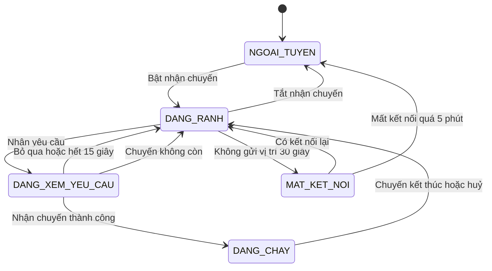
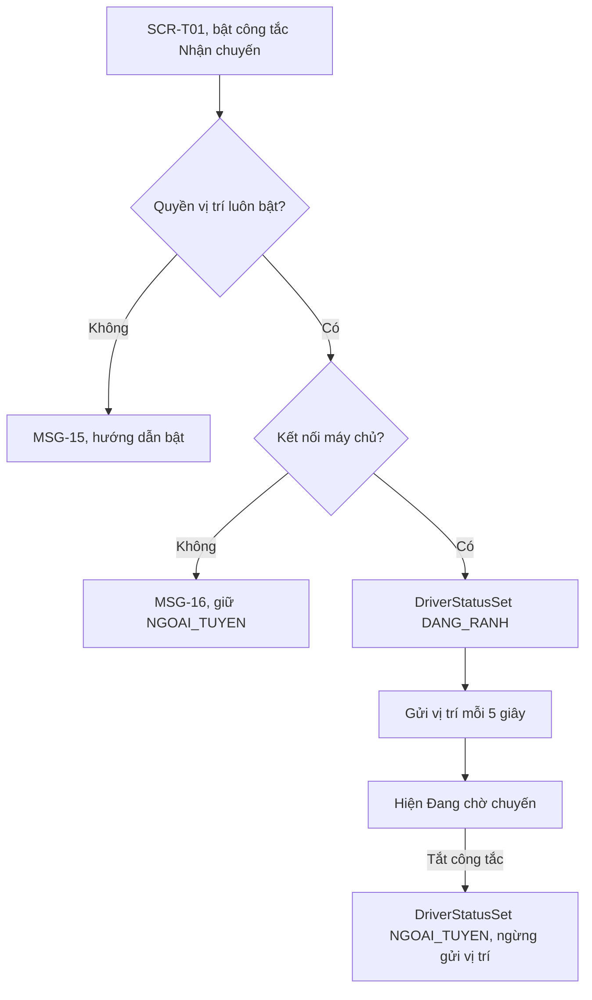
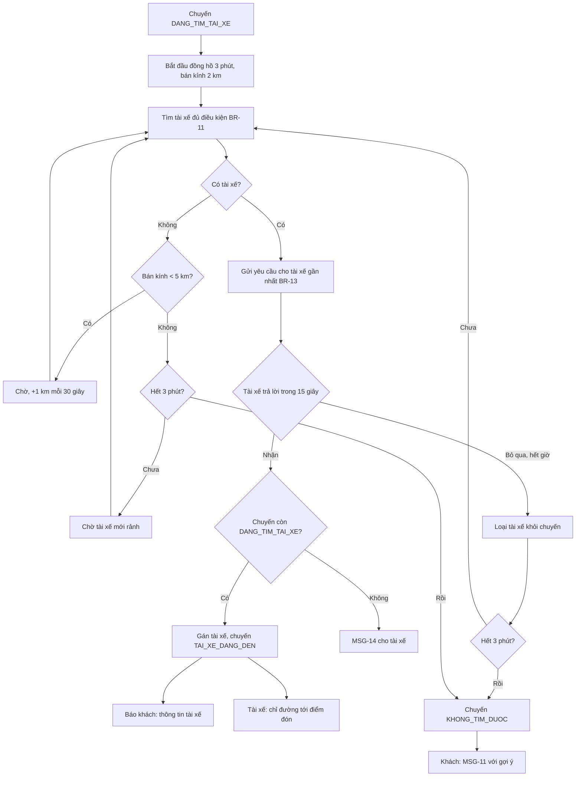
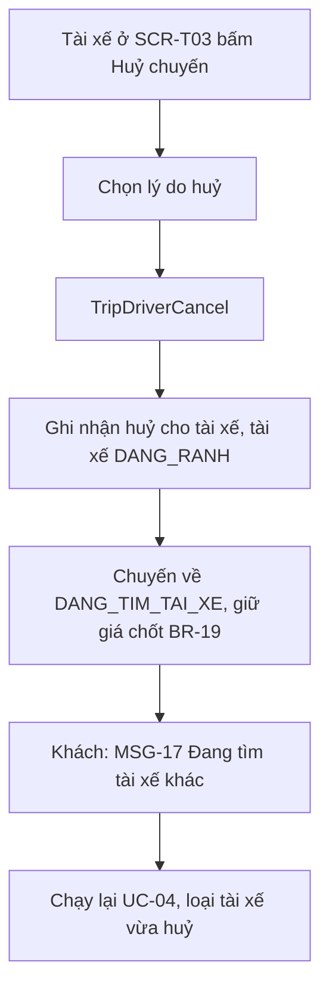
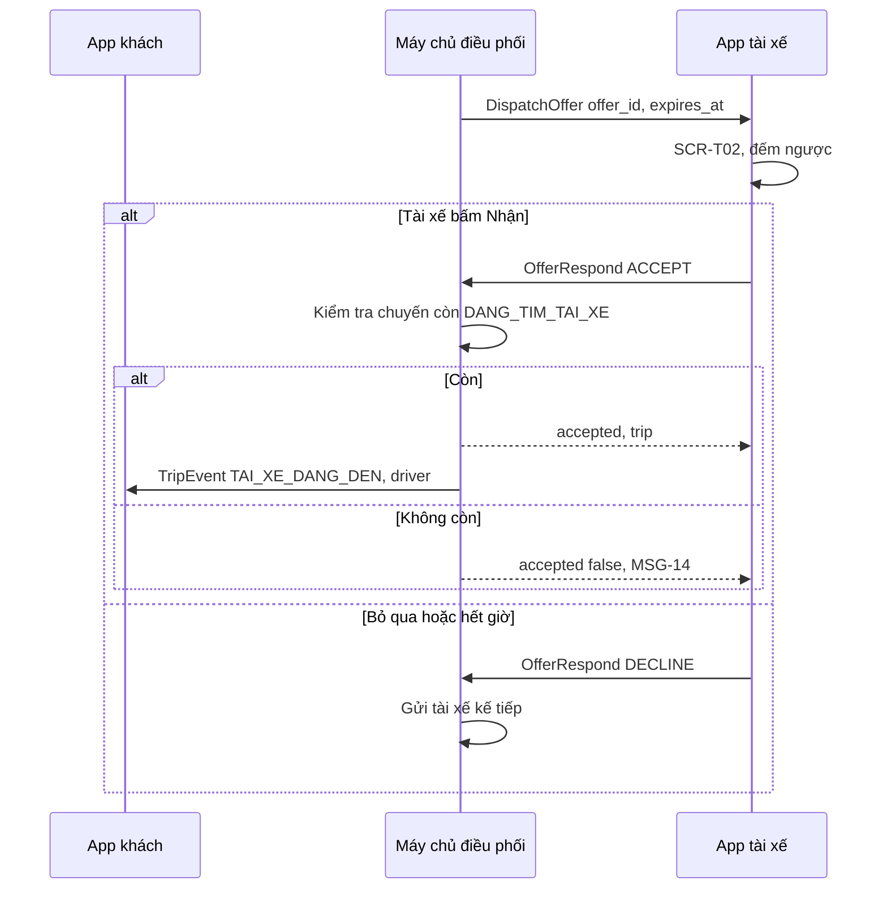

> **Mã:** DE04-TN02-SRS · **Trạng thái:** nháp · **Người viết:** Design (mock) · **PRD:** [PRD.md](PRD.md)

# UC-DE04-02 - Ghép tài xế và nhận chuyến

> **Bản mock.** Giá trị `[giả định]` cần BA xác nhận. SRS này mô tả chuyến từ `DANG_TIM_TAI_XE` tới `TAI_XE_DANG_DEN` hoặc `KHONG_TIM_DUOC`; theo dõi chuyến xem [SRS TN03](../TN03-theo-doi-chuyen-an-toan/SRS.md); huỷ và phí huỷ xem [SRS TN04](../TN04-thanh-toan-danh-gia-huy/SRS.md).

## 1. Tổng quan

| **Mục** | **Nội dung** |
| --- | --- |
| Mục tiêu | Ghép chuyến với một tài xế phù hợp; tài xế nhận hoặc bỏ qua; khách thấy trạng thái tìm và thông tin tài xế |
| Actor | Khách · Tài xế · App khách · App tài xế · Máy chủ điều phối |
| Phạm vi | Bật, tắt nhận chuyến; thuật toán gửi lần lượt; thẻ yêu cầu; màn chờ của khách; không tìm được tài xế; tài xế huỷ sau khi nhận |
| Ngoài phạm vi | Danh sách chuyến chờ, ghép nối tiếp, tài xế yêu thích |
| Nền tảng | App khách, App tài xế iOS / Android `[giả định]` |

## 2. User Story

| **ID** | **As a** | **I want** | **So that** |
| --- | --- | --- | --- |
| US-06 | Tài xế | Bật, tắt nhận chuyến | Chỉ nhận yêu cầu khi sẵn sàng |
| US-07 | Tài xế | Thấy đủ thông tin chuyến trong thẻ yêu cầu | Quyết định nhanh và đúng |
| US-08 | Tài xế | Nhận bằng một chạm | An toàn khi đang lái |
| US-09 | Khách | Biết hệ thống đang tìm tài xế | Không đặt lại, không huỷ vội |
| US-10 | Khách | Thấy ngay tài xế nào sẽ đến | Nhận ra xe khi tới |
| US-11 | Khách | Được gợi ý khi không tìm được tài xế | Vẫn có cách đi |

## 3. Business Rules

| **Mã** | **Quy tắc** |
| --- | --- |
| BR-11 | **Tài xế đủ điều kiện**: trạng thái `DANG_RANH`, đúng loại xe, vị trí cập nhật trong 30 giây gần nhất, trong bán kính tìm, chưa bỏ qua chuyến này `[giả định]` |
| BR-12 | **Bán kính tìm** bắt đầu 2 km, +1 km mỗi 30 giây, tối đa 5 km |
| BR-13 | **Thứ tự gửi**: tài xế có thời gian đi tới điểm đón ngắn nhất trước; bằng nhau thì ưu tiên tài xế chờ lâu nhất kể từ chuyến trước |
| BR-14 | **Gửi lần lượt**: mỗi yêu cầu chỉ gửi cho 1 tài xế; tài xế đó chuyển `DANG_XEM_YEU_CAU` và không nhận yêu cầu khác cho tới khi trả lời |
| BR-15 | **Thời gian trả lời** 15 giây tính trên máy chủ; app hiện đếm ngược theo thời điểm hết hạn máy chủ gửi về. Hết giờ hoặc Bỏ qua → gửi tài xế kế tiếp |
| BR-16 | **Nhận chuyến**: máy chủ kiểm tra chuyến còn `DANG_TIM_TAI_XE` và yêu cầu còn hạn; đúng → gán tài xế, chuyến `TAI_XE_DANG_DEN`, tài xế `DANG_CHAY`. Sai → MSG-14 cho tài xế |
| BR-17 | **Thời gian tìm tối đa** 3 phút; hết giờ → chuyến `KHONG_TIM_DUOC`, không thu phí |
| BR-18 | **Thu nhập dự kiến** trên thẻ = giá chốt × (1 − tỉ lệ chiết khấu); tỉ lệ theo loại xe `[giả định]` |
| BR-19 | **Tài xế huỷ sau khi nhận** (trước khi bắt đầu chuyến, tức ở `TAI_XE_DANG_DEN`, `TAI_XE_DA_DEN`, hoặc `DANG_CHO_KHACH` khi chưa hết 10 phút chờ tính phí): chuyến quay về `DANG_TIM_TAI_XE`, khách không mất phí huỷ, phí chờ đã phát sinh (nếu có) bị xoá, giữ nguyên giá chốt, đồng hồ 3 phút tính lại từ đầu; tài xế vừa huỷ bị loại khỏi chuyến này. Mỗi chuyến tìm lại tối đa 2 lần; tài xế thứ 3 huỷ → chuyến `KHONG_TIM_DUOC`, không thu phí |
| BR-20 | **Tắt nhận chuyến** khi đang xem yêu cầu → tính là bỏ qua. Mất kết nối > 30 giây khi rảnh → tạm không được gửi yêu cầu |
| BR-46 | **Bỏ qua nhiều lần**: tài xế bỏ qua hoặc để hết giờ **3 yêu cầu liên tiếp** → tự chuyển sang Tắt nhận chuyến, hiện MSG-39; tài xế bật lại thủ công được ngay. Bộ đếm về 0 khi nhận một chuyến `[giả định]` |

## 4. Trạng thái

### 4.1 Trạng thái tài xế

### 4.2 Trạng thái một yêu cầu gửi tài xế

| **Trạng thái** | **Điều kiện** | **Hiển thị (App tài xế)** |
| --- | --- | --- |
| `DA_GUI` | Máy chủ đã gửi, tài xế chưa trả lời | Thẻ **SCR-T02**, đếm ngược |
| `DA_NHAN` | Tài xế nhận, máy chủ chấp nhận | Chuyển sang **SCR-T03** |
| `BO_QUA` | Tài xế bấm Bỏ qua | Đóng thẻ, về **SCR-T01** |
| `HET_HAN` | Hết 15 giây | Đóng thẻ, MSG-13 |
| `HUY_BO` | Khách huỷ hoặc chuyến đã có tài xế khác | Đóng thẻ, MSG-14 |

### 4.3 Khách thấy gì theo trạng thái chuyến

| **Trạng thái chuyến** | **App khách** |
| --- | --- |
| `DANG_TIM_TAI_XE` | **SCR-K04** hiệu ứng tìm, thời gian chờ, nút Huỷ |
| `TAI_XE_DANG_DEN` | **SCR-K05** thông tin tài xế (SRS TN03) |
| `KHONG_TIM_DUOC` | **SCR-K04** chuyển sang MSG-11 với gợi ý |

## 5. Use Case

### UC-03 Tài xế bật nhận chuyến

| **Mục** | **Nội dung** |
| --- | --- |
| Tiền điều kiện | Tài xế đăng nhập, hồ sơ đã duyệt |
| Hậu điều kiện thành công | Tài xế `DANG_RANH`, vị trí gửi mỗi 5 giây |
| Hậu điều kiện thất bại | Tài xế `NGOAI_TUYEN` |

**Luồng chính**

| **Bước** | **Actor** | **Mô tả** |
| --- | --- | --- |
| 1 | Tài xế | Ở **SCR-T01**, bật công tắc Nhận chuyến |
| 2 | Hệ thống | Kiểm tra quyền vị trí "Luôn cho phép" và kết nối máy chủ |
| 3 | Hệ thống | Gọi \[DriverStatusSet\] `DANG_RANH` |
| 4 | Hệ thống | Gửi vị trí mỗi 5 giây |
| 5 | Hệ thống | Hiện "Đang chờ chuyến" |

**Luồng thay thế**

| **Mã** | **Điều kiện** | **Xử lý** |
| --- | --- | --- |
| A1 | Tài xế tắt công tắc | \[DriverStatusSet\] `NGOAI_TUYEN`, ngừng gửi vị trí |

**Luồng lỗi**

| **Mã** | **Điều kiện** | **Xử lý** |
| --- | --- | --- |
| E1 | Chưa cấp quyền vị trí "Luôn cho phép" | MSG-15 kèm hướng dẫn bật; giữ `NGOAI_TUYEN` |
| E2 | Không kết nối được máy chủ | MSG-16; giữ `NGOAI_TUYEN` |

### UC-04 Ghép tài xế

| **Mục** | **Nội dung** |
| --- | --- |
| Tiền điều kiện | Chuyến `DANG_TIM_TAI_XE` (SRS TN01) |
| Hậu điều kiện thành công | Chuyến `TAI_XE_DANG_DEN` với một tài xế |
| Hậu điều kiện thất bại | Chuyến `KHONG_TIM_DUOC` hoặc `DA_HUY` |

**Luồng chính**

| **Bước** | **Actor** | **Mô tả** |
| --- | --- | --- |
| 1 | Máy chủ | Nhận chuyến mới `DANG_TIM_TAI_XE`; bắt đầu đồng hồ 3 phút (BR-17) |
| 2 | Máy chủ | Lọc tài xế theo BR-11, BR-12; sắp theo BR-13 |
| 3 | Máy chủ | Gửi yêu cầu cho tài xế đầu danh sách (BR-14), hết hạn sau 15 giây (BR-15) |
| 4 | App tài xế | Hiện **SCR-T02** với âm thanh, rung, đếm ngược |
| 5 | Tài xế | Bấm "Nhận" |
| 6 | Máy chủ | Kiểm tra BR-16; gán tài xế; đẩy cập nhật cho cả hai app |
| 7 | App khách | **SCR-K04** chuyển sang **SCR-K05** với thông tin tài xế |
| 8 | App tài xế | Mở **SCR-T03** chỉ đường tới điểm đón |

**Luồng thay thế**

| **Mã** | **Điều kiện** | **Xử lý** |
| --- | --- | --- |
| A1 | Tài xế bỏ qua hoặc hết 15 giây | Loại tài xế khỏi chuyến; quay lại bước 2 |
| A2 | Không có tài xế trong bán kính | Mở rộng bán kính theo BR-12; khách thấy MSG-10 sau 60 giây |
| A3 | Khách huỷ khi đang tìm | Chuyến `DA_HUY` (SRS TN04); yêu cầu đang gửi → `HUY_BO`, tài xế thấy MSG-14 |
| A4 | Tài xế bấm Nhận lúc khách vừa huỷ | Máy chủ từ chối theo BR-16; MSG-14 |
| A5 | App khách ở nền khi ghép xong | Thông báo đẩy MSG-12 |

**Luồng lỗi**

| **Mã** | **Điều kiện** | **Xử lý** |
| --- | --- | --- |
| E1 | Hết 3 phút | Chuyến `KHONG_TIM_DUOC`; khách thấy MSG-11 |
| E2 | App tài xế mất kết nối khi đang xem yêu cầu | Máy chủ tính hết hạn sau 15 giây; app có mạng lại thì đóng thẻ |
| E3 | Tài xế bấm Nhận khi mạng chập chờn | Nút loading; chờ phản hồi máy chủ tối đa 5 giây; không có phản hồi → hỏi lại trạng thái chuyến trước khi báo |

### UC-05 Tài xế huỷ sau khi nhận

| **Mục** | **Nội dung** |
| --- | --- |
| Tiền điều kiện | Chuyến `TAI_XE_DANG_DEN`, `TAI_XE_DA_DEN`, hoặc `DANG_CHO_KHACH` chưa hết 10 phút chờ tính phí; chưa bắt đầu chuyến. Hết 10 phút chờ tính phí thì tài xế dùng "Khách không đến" (SRS TN04, BR-37) |
| Hậu điều kiện | Chuyến quay về `DANG_TIM_TAI_XE`; khách được tìm tài xế mới |

**Luồng chính**

| **Bước** | **Actor** | **Mô tả** |
| --- | --- | --- |
| 1 | Tài xế | Ở **SCR-T03**, bấm Huỷ chuyến |
| 2 | Tài xế | Chọn lý do huỷ |
| 3 | Hệ thống | Gọi \[TripDriverCancel\]; ghi nhận lượt huỷ cho tài xế, tài xế về `DANG_RANH` |
| 4 | Hệ thống | Chuyến về `DANG_TIM_TAI_XE`, giữ giá chốt, xoá phí chờ đã phát sinh (BR-19) |
| 5 | Hệ thống | Khách nhận MSG-17 |
| 6 | Hệ thống | Chạy lại UC-04, loại tài xế vừa huỷ |

**Luồng thay thế**

| **Mã** | **Điều kiện** | **Xử lý** |
| --- | --- | --- |
| A1 | Đã tìm lại 2 lần mà tài xế thứ 3 vẫn huỷ | Chuyến `KHONG_TIM_DUOC`, không thu phí (BR-19) |

## 6. Điểm vào

| **Điểm vào** | **Dẫn tới** | **Ghi chú** |
| --- | --- | --- |
| Công tắc Nhận chuyến ở **SCR-T01** | UC-03 | |
| Chuyến vừa tạo ở TN01 | UC-04, **SCR-K04** | |
| Yêu cầu đến (kết nối realtime hoặc thông báo đẩy) | **SCR-T02** | Mở được cả khi app ở nền |
| Nút Huỷ ở **SCR-T03** | UC-05 | Chi tiết huỷ và lý do ở SRS TN04 |

## 7. Mô tả màn hình

### SCR-K04 Đang tìm tài xế (App khách)

| **#** | **Thành phần** | **Loại** | **Hành vi** |
| --- | --- | --- | --- |
| 1 | Bản đồ | Map | Điểm đón, vòng bán kính tìm mở rộng theo BR-12 |
| 2 | Trạng thái | Text | "Đang tìm tài xế gần bạn" + "{mm:ss}"; sau 60 giây thêm MSG-10 |
| 3 | Tóm tắt chuyến | Card | Loại xe, điểm đón, điểm đến, giá chốt |
| 4 | Huỷ chuyến | Button text | Huỷ miễn phí khi đang tìm (SRS TN04) |
| 5 | Không tìm được | Panel | MSG-11; danh sách loại xe khác đang có tài xế, kèm giá; nút "Thử lại" |

### SCR-T01 Trang chủ, bật nhận chuyến (App tài xế)

| **#** | **Thành phần** | **Loại** | **Hành vi** |
| --- | --- | --- | --- |
| 1 | Công tắc Nhận chuyến | Toggle lớn | Bật, tắt theo UC-03 |
| 2 | Trạng thái | Banner | "Đang chờ chuyến" / "Đang nghỉ" / "Mất kết nối" |
| 3 | Bản đồ | Map | Vị trí tài xế |
| 4 | Thu nhập hôm nay | Card | Số chuyến, tổng thu nhập trong ngày |

### SCR-T02 Yêu cầu chuyến mới (App tài xế, toàn màn)

| **#** | **Thành phần** | **Loại** | **Hành vi** |
| --- | --- | --- | --- |
| 1 | Đếm ngược | Vòng tròn | 15 giây theo thời điểm hết hạn của máy chủ |
| 2 | Thu nhập dự kiến | Số lớn | BR-18 |
| 3 | Tới điểm đón | Text | "{km} km · {phút} phút" |
| 4 | Điểm đón | Text | Tên điểm, ghi chú của khách |
| 5 | Quãng đường chuyến | Text | Chỉ "{km} km chuyến đi" và hướng đi (ví dụ "Về phía Quận 1"); **không hiện tên điểm đến** trước khi nhận. Nhận xong mới hiện điểm đến ở **SCR-T03** |
| 6 | Thông tin khách | Text phụ | Đánh giá của khách, phương thức thanh toán |
| 7 | Nút "Nhận" | Button lớn | Chiếm phần lớn chiều rộng; loading khi đang gửi |
| 8 | Nút "Bỏ qua" | Button phụ | |
| 9 | Âm thanh, rung | Hệ thống | Lặp tới khi trả lời hoặc hết giờ |

## 8. API

| **API** | **Request chính** | **Response chính** | **Timeout / retry** `[giả định]` |
| --- | --- | --- | --- |
| \[DriverStatusSet\] | driver_id, status | status hiện tại | 5s / 2 lần |
| \[DriverLocationPush\] | driver_id, lat, lng, heading, accuracy | – | Mỗi 5 giây khi `DANG_RANH`, `DANG_CHAY` |
| \[DispatchOffer\] (máy chủ → tài xế) | offer_id, trip_id, thông tin chuyến (không gồm điểm đến, chỉ km và hướng đi), expires_at | – | Qua kết nối realtime; dự phòng thông báo đẩy |
| \[OfferRespond\] | offer_id, action (ACCEPT, DECLINE) | accepted, trip | 5s / không tự retry; hỏi \[TripGet\] khi không rõ |
| \[TripEvent\] (máy chủ → khách) | trip_id, status, driver | – | Qua kết nối realtime; dự phòng thông báo đẩy |
| \[TripGet\] | trip_id | Trạng thái và thông tin đầy đủ của chuyến | 5s / 2 lần |
| \[TripDriverCancel\] | trip_id, reason | – | 5s / 2 lần |

**Map lỗi → thông báo**

| **Nhóm lỗi** | **Message** |
| --- | --- |
| Yêu cầu hết hạn trước khi tài xế trả lời | MSG-13 |
| Chuyến không còn (khách huỷ, tài xế khác đã nhận) | MSG-14 |
| Chưa cấp quyền vị trí "Luôn cho phép" | MSG-15 |
| Mất kết nối | MSG-16 |
| Hết thời gian tìm tài xế | MSG-11 |

## 9. Danh sách thông báo

| **ID** | **Nơi hiện** | **Nội dung (VI)** |
| --- | --- | --- |
| MSG-10 | **SCR-K04** | Đang mở rộng khu vực tìm tài xế |
| MSG-11 | **SCR-K04** | Hiện chưa có tài xế nhận chuyến. Bạn không bị tính phí. \[Thử lại\] \[Chọn loại xe khác\] |
| MSG-12 | Thông báo đẩy (khách) | {Tên tài xế} đang đến đón bạn · {biển số} · {n} phút |
| MSG-13 | Toast (tài xế) | Đã bỏ qua yêu cầu vì hết thời gian |
| MSG-14 | Toast (tài xế) | Chuyến này không còn |
| MSG-15 | Popup (tài xế) | Cần bật vị trí "Luôn cho phép" để nhận chuyến. \[Mở Cài đặt\] |
| MSG-16 | Toast (tài xế) | Chưa kết nối được, vui lòng kiểm tra mạng |
| MSG-39 | Popup (tài xế) | Bạn đã bỏ qua 3 chuyến liên tiếp nên đã được chuyển sang Tạm nghỉ. Bật lại khi sẵn sàng nhận chuyến. \[Bật nhận chuyến\] |

MSG-17 thuộc SRS TN03.

## 10. Yêu cầu phi chức năng

| **Mục** | **Yêu cầu** `[giả định]` |
| --- | --- |
| Hiệu năng | Yêu cầu hiện trên App tài xế ≤ 2 giây sau khi máy chủ gửi; cập nhật ghép xong tới App khách ≤ 2 giây |
| Nhất quán | Máy chủ là nguồn đúng về trạng thái; một chuyến chỉ có một tài xế; app không tự kết luận khi chưa có phản hồi |
| Realtime | Kết nối realtime giữ khi tài xế bật nhận chuyến; tự kết nối lại; thông báo đẩy làm dự phòng |
| Pin, dữ liệu | Gửi vị trí 5 giây khi rảnh, giảm tần suất khi đứng yên lâu |
| Log / audit | Mỗi offer: offer_id, trip_id, driver_id, thời điểm gửi, trả lời, kết quả |
| Bảo mật | Thẻ yêu cầu không hiện số điện thoại của khách; vị trí tài xế chỉ gửi khi đang bật nhận chuyến hoặc đang có chuyến; khách chỉ thấy vị trí tài xế của chuyến mình |
| Tracking | Bật, tắt nhận chuyến; offer gửi, nhận, bỏ qua, hết hạn; thời gian ghép; không tìm được; huỷ sau nhận |
| Accessibility | Nút Nhận ≥ 64 pt chiều cao; âm thanh và rung đủ mạnh; đếm ngược có số, không chỉ vòng màu |
