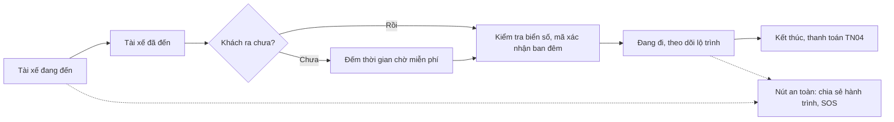

> **Mã:** DE04-TN03-PRD · **Trạng thái:** nháp · **Người viết:** Design (mock) · **SRS:** [SRS.md](SRS.md)

# PRD Theo dõi chuyến và an toàn (App đặt xe công nghệ)

> **Bản mock.** Con số đánh dấu `[giả định]` dùng để dựng flow, cần PO xác nhận trước khi dùng.

## 1. Bối cảnh và vấn đề

### 1.1 Bối cảnh

Từ lúc tài xế nhận chuyến ([TN02](../TN02-ghep-tai-xe-nhan-chuyen/PRD.md)) tới lúc kết thúc, chuyến đi qua nhiều trạng thái và cả hai phía cần thấy cùng một thông tin: tài xế đang ở đâu, đã đến chưa, đang đi tới đâu. Đây cũng là lúc khách cần cảm thấy an toàn nhất khi đi cùng người lạ.

### 1.2 Vấn đề

| **Vấn đề** | **Hệ quả** |
| --- | --- |
| Khách không biết tài xế còn bao xa | Ra đứng chờ quá sớm hoặc quá muộn |
| Khó nhận ra đúng xe ở chỗ đông | Lên nhầm xe, mất an toàn |
| Gọi điện lộ số điện thoại cá nhân | Lo bị làm phiền sau chuyến |
| Tài xế đến mà khách chưa ra | Tài xế chờ không công, huỷ chuyến |
| Gặp sự cố không biết gọi ai | Hoảng loạn, không có hỗ trợ kịp thời |
| Người thân không biết mình đang đi tới đâu | Lo lắng khi đi đêm |

### 1.3 Mục tiêu

- ≥ 95% chuyến khách thấy vị trí tài xế cập nhật đều, không trễ quá 10 giây `[giả định]`.
- Tỉ lệ lên nhầm xe ≈ 0.
- Mọi lời gọi giữa khách và tài xế đi qua số trung gian.

## 2. Người dùng

| **Nhóm** | **Nhu cầu với tính năng này** |
| --- | --- |
| Khách đi làm | Biết chính xác khi nào ra đón xe |
| Phụ nữ đi đêm | Chia sẻ hành trình cho người thân, nút SOS dễ thấy |
| Khách lớn tuổi | Gọi tài xế dễ dàng, nhận ra xe nhờ biển số to |
| Tài xế | Liên lạc khách khi không tìm thấy; chỉ đường tới điểm đón, điểm đến |

## 3. Phạm vi

### 3.1 Trong phạm vi (MVP)

- Vị trí tài xế realtime trên bản đồ, thời gian đến cập nhật liên tục.
- Trạng thái chuyến hai phía: đang đến, đã đến, đang chờ, đang đi, kết thúc.
- Gọi và nhắn tin qua kênh ẩn số; tin nhắn mẫu nhanh.
- Thời gian chờ miễn phí khi tài xế đã đến.
- Chia sẻ hành trình qua đường link cho người thân.
- Nút SOS: gọi số khẩn cấp, gửi vị trí cho liên hệ khẩn cấp và đội an toàn.
- Mã xác nhận chuyến cho chuyến đi đêm `[giả định]`.

### 3.2 Ngoài phạm vi

- Ghi âm trong chuyến.
- Phát hiện bất thường tự động (dừng lâu, lệch lộ trình) → phase sau.
- Đổi điểm đến giữa chuyến.
- Chat với tổng đài trong app.

## 4. Nguyên tắc sản phẩm

### 4.1 Cùng một sự thật cho cả hai phía

Khách và tài xế luôn thấy cùng trạng thái chuyến. Đổi trạng thái chỉ do tài xế bấm và được máy chủ xác nhận.

### 4.2 Nhận ra xe trước khi lên xe

Biển số in to nhất trên màn, kèm hãng, màu xe và ảnh tài xế.

### 4.3 An toàn luôn trong tầm tay

Nút an toàn có mặt ở mọi trạng thái từ khi có tài xế đến khi kết thúc chuyến, mở được bằng một chạm.

### 4.4 Riêng tư hai chiều

Không bên nào thấy số điện thoại thật của bên kia. Link chia sẻ hành trình hết hạn khi chuyến kết thúc.

## 5. Quy tắc nghiệp vụ

| **Quy tắc** | **Giá trị** `[giả định]` |
| --- | --- |
| Tần suất vị trí tài xế | 5 giây khi có chuyến |
| Bấm "Đã đến" | Chỉ khi tài xế cách điểm đón ≤ 100 m |
| Thời gian chờ miễn phí | Xe máy 3 phút, ô tô 5 phút |
| Phí chờ | Sau thời gian miễn phí, mỗi phút 1.000 ₫ (xe máy), 2.000 ₫ (ô tô); tối đa 10 phút |
| Kênh liên lạc | Số trung gian, có hiệu lực tới 30 phút sau khi kết thúc chuyến |
| Link chia sẻ hành trình | Hết hạn khi chuyến kết thúc |
| Mã xác nhận chuyến | 4 số, áp dụng cho chuyến 22:00–05:00 |
| Liên hệ khẩn cấp | Tối đa 3 người |

- Các giá trị trên là **cấu hình theo thành phố**, không cố định trong code.

## 6. Luồng trải nghiệm

| **Bước** | **Giai đoạn** | **Trải nghiệm khách** | **Trải nghiệm tài xế** |
| --- | --- | --- | --- |
| 1 | Đang đến | Xe di chuyển trên bản đồ, "Đến trong {n} phút"; gọi, nhắn tài xế | Chỉ đường tới điểm đón; gọi, nhắn khách |
| 2 | Đã đến | Thông báo "Tài xế đã đến", đếm thời gian chờ | Bấm "Đã đến"; đếm thời gian chờ |
| 3 | Lên xe | Kiểm tra biển số; đọc mã xác nhận (ban đêm) | Hỏi mã, bấm "Bắt đầu chuyến" |
| 4 | Đang đi | Lộ trình, thời gian tới nơi; chia sẻ hành trình, SOS | Chỉ đường tới điểm đến |
| 5 | Kết thúc | Màn thanh toán (TN04) | Bấm "Kết thúc chuyến" |

## 7. Use Cases, User Stories và Acceptance Criteria

### UC1. Theo dõi tài xế đến đón

#### US1.1 Thấy tài xế đang đến

User Story: Là khách, tôi muốn thấy tài xế đang ở đâu và bao lâu nữa đến để ra đón xe đúng lúc.

AC01: Bản đồ hiện xe tài xế di chuyển mượt, cập nhật mỗi 5 giây.

AC02: "Đến trong {n} phút" cập nhật theo vị trí thật.

AC03: Biển số hiện to nhất; kèm ảnh, tên, đánh giá, hãng và màu xe.

AC04: Mất kết nối vị trí tài xế > 30 giây → hiện "Đang cập nhật vị trí tài xế", giữ vị trí cuối.

#### US1.2 Liên hệ với nhau

User Story: Là khách hoặc tài xế, tôi muốn gọi, nhắn tin cho bên kia mà không lộ số điện thoại để liên lạc an toàn.

AC01: Nút Gọi và Nhắn tin ở cả hai app; gọi qua số trung gian.

AC02: Tin nhắn mẫu nhanh: "Tôi đang ra", "Tôi đứng ở cổng", "Anh/chị ở đâu ạ?".

AC03: Tin nhắn mới có thông báo, kể cả khi app ở nền.

### UC2. Đón khách

#### US2.1 Tài xế báo đã đến

User Story: Là tài xế, tôi muốn báo đã đến điểm đón để khách ra đúng lúc và trạng thái chuyến đúng thực tế.

AC01: Nút "Đã đến" chỉ bật khi tài xế cách điểm đón ≤ 100 m.

AC02: Khách nhận thông báo "Tài xế đã đến" kèm biển số.

AC03: Hai phía cùng thấy đồng hồ thời gian chờ miễn phí; hết giờ thì báo cho khách là bắt đầu tính phí chờ.

#### US2.2 Bắt đầu chuyến an toàn

User Story: Là khách đi đêm, tôi muốn tài xế phải nhập mã xác nhận trước khi bắt đầu chuyến để không lên nhầm xe.

AC01: Chuyến 22:00–05:00 hiện mã xác nhận 4 số cho khách; tài xế nhập đúng mã mới bắt đầu được.

AC02: Tài xế bấm "Bắt đầu chuyến" → hai phía chuyển sang "Đang đi".

### UC3. An toàn trong chuyến

#### US3.1 Chia sẻ hành trình

User Story: Là khách đi đêm, tôi muốn người thân thấy tôi đang đi tới đâu.

AC01: Nút "Chia sẻ hành trình" tạo link xem trên trình duyệt: biển số, tài xế, vị trí xe, thời gian tới nơi.

AC02: Link hết hạn khi chuyến kết thúc hoặc bị huỷ.

#### US3.2 SOS

User Story: Là khách, tôi muốn gọi trợ giúp khẩn cấp nhanh để an toàn khi có sự cố.

AC01: Nút an toàn ở góc màn, mở bảng gồm: Gọi 113, Gửi vị trí cho liên hệ khẩn cấp, Báo đội an toàn.

AC02: Gọi 113 cần giữ nút 2 giây để tránh bấm nhầm.

AC03: Gửi vị trí cho liên hệ khẩn cấp qua SMS kèm link hành trình.

AC04: Chưa có liên hệ khẩn cấp → mời thêm ngay tại bảng.

### UC4. Kết thúc chuyến

AC01: Tài xế bấm "Kết thúc chuyến" tại điểm đến hoặc nơi khách xuống; xa điểm đến > 500 m thì hỏi xác nhận.

AC02: Hai phía chuyển sang màn thanh toán (TN04).

## 8. Chỉ số theo dõi `[giả định]`

| **Chỉ số** | **Định nghĩa** | **Mục tiêu MVP** |
| --- | --- | --- |
| Độ trễ vị trí | Từ tài xế gửi vị trí tới app khách hiện | ≤ 10 giây ở ≥ 95% lần |
| Độ chính xác thời gian đến | Thời gian đến dự báo lúc nhận so với thực tế | Sai lệch ≤ 2 phút ở ≥ 80% chuyến |
| Tỉ lệ dùng liên lạc | Chuyến có gọi hoặc nhắn / tổng chuyến | Theo dõi; cao là dấu hiệu điểm đón chưa rõ |
| Thời gian chờ thực tế | Từ Đã đến tới Bắt đầu chuyến | Theo dõi |
| Tỉ lệ chia sẻ hành trình | Chuyến có chia sẻ / tổng chuyến | Theo dõi |
| Lượt SOS | Số lượt mở bảng an toàn, gọi 113 | Theo dõi, mọi lượt đều được đội an toàn xem lại |

## 9. Phụ thuộc và rủi ro

| **Mục** | **Mô tả** | **Hướng xử lý** |
| --- | --- | --- |
| Kết nối mạng tài xế | Mất mạng giữa đường | Lưu vị trí, gửi bù khi có mạng; khách thấy trạng thái đang cập nhật |
| Dịch vụ số trung gian | Phụ thuộc nhà cung cấp viễn thông | Nhắn tin trong app làm dự phòng |
| SOS bấm nhầm | Gọi 113 ngoài ý muốn | Giữ 2 giây; đếm ngược có nút huỷ |
| Lạm dụng link chia sẻ | Người lạ xem vị trí | Link khó đoán, hết hạn khi kết thúc |
| Tài xế bấm Bắt đầu khi khách chưa lên | Tính tiền sai | Mã xác nhận ban đêm; khách báo cáo được ở TN04 |

## 10. Câu hỏi mở

> Câu nào đã có giá trị ở mục 5 thì giá trị đó là **tạm chốt** `[giả định]` để dựng flow. Câu hỏi vẫn để mở cho đến khi PO xác nhận.

- Mã xác nhận có áp dụng cho mọi chuyến, không chỉ ban đêm?
- Phí chờ có áp dụng cho xe máy không?
- Đội an toàn hoạt động 24/7 hay theo khung giờ? → **Đã chốt:** Trực 24/7.
- Có phát hiện xe dừng lâu bất thường ngay ở MVP?
