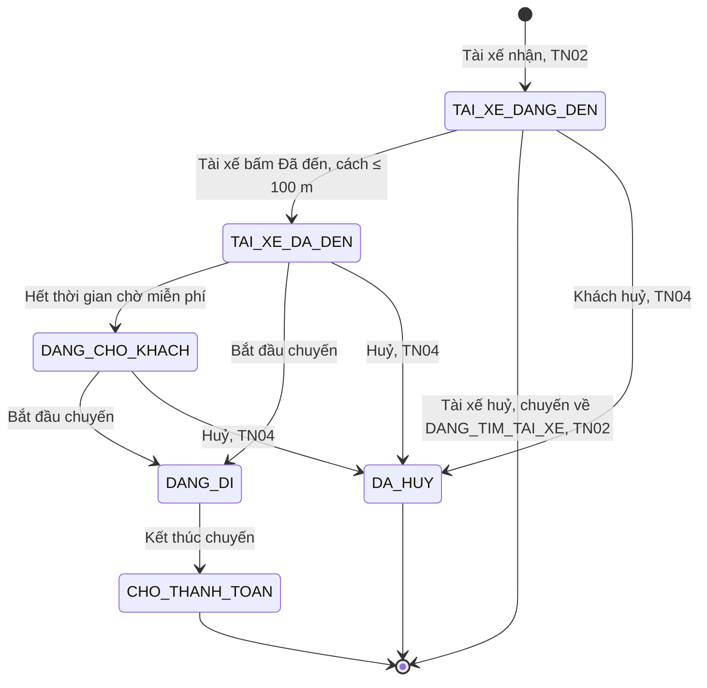
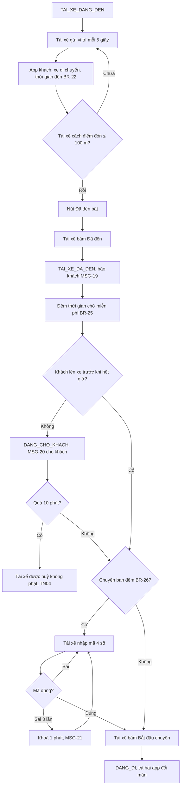
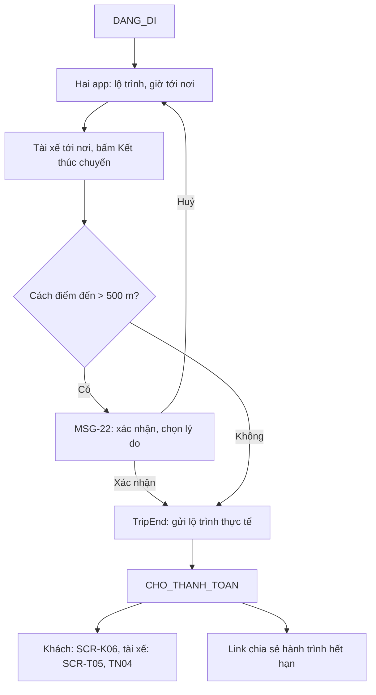
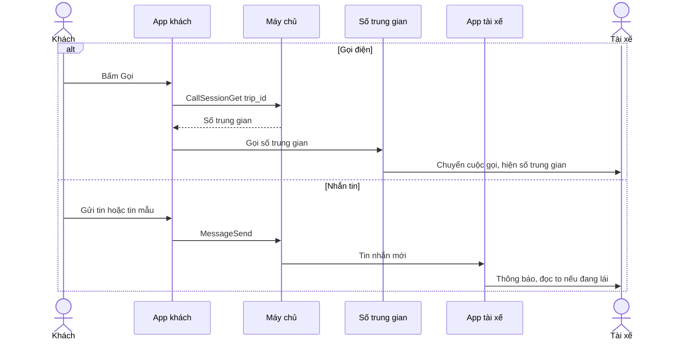
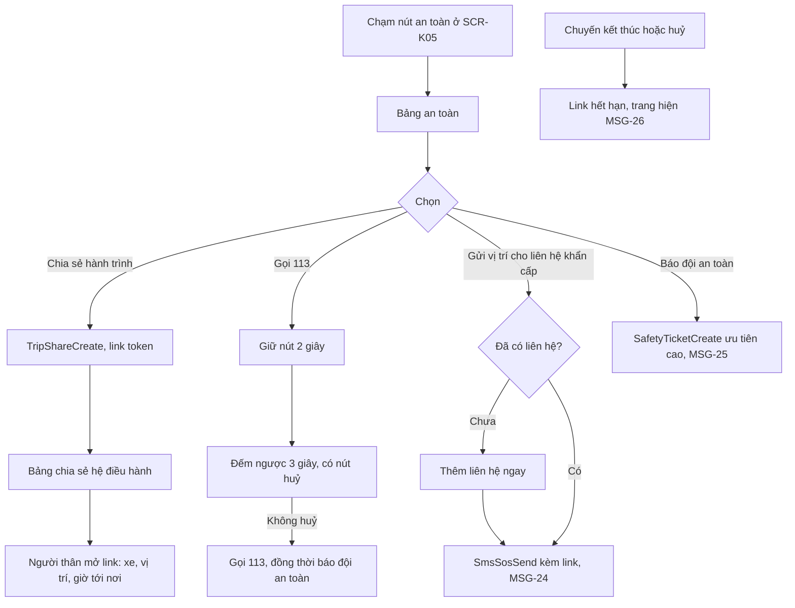
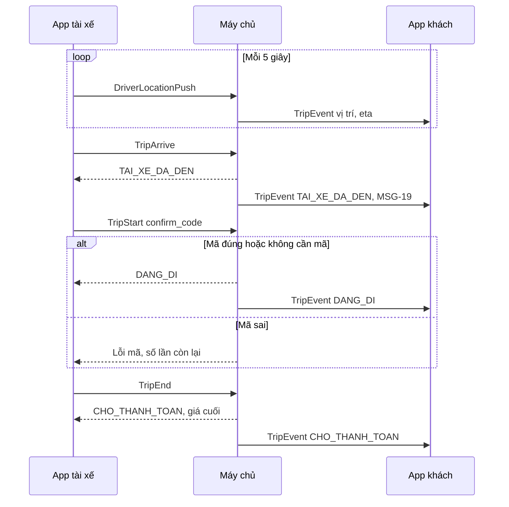

> **Mã:** DE04-TN03-SRS · **Trạng thái:** nháp · **Người viết:** Design (mock) · **PRD:** [PRD.md](PRD.md)

# UC-DE04-03 - Theo dõi chuyến và an toàn

> **Bản mock.** Giá trị `[giả định]` cần BA xác nhận. SRS này mô tả chuyến từ `TAI_XE_DANG_DEN` tới `CHO_THANH_TOAN`; ghép tài xế xem [SRS TN02](../TN02-ghep-tai-xe-nhan-chuyen/SRS.md); thanh toán, huỷ xem [SRS TN04](../TN04-thanh-toan-danh-gia-huy/SRS.md).

## 1. Tổng quan

| **Mục** | **Nội dung** |
| --- | --- |
| Mục tiêu | Hai phía theo dõi chuyến realtime với cùng trạng thái; liên lạc ẩn số; khách có công cụ an toàn |
| Actor | Khách · Tài xế · App khách · App tài xế · Máy chủ · Dịch vụ số trung gian · Người thân (xem link) |
| Phạm vi | Vị trí realtime, đã đến, thời gian chờ, mã xác nhận, bắt đầu và kết thúc chuyến, gọi, nhắn tin, chia sẻ hành trình, SOS |
| Ngoài phạm vi | Ghi âm, phát hiện bất thường tự động, đổi điểm đến giữa chuyến |
| Nền tảng | App khách, App tài xế iOS / Android; trang xem hành trình trên Web `[giả định]` |
| Figma | `[chưa có]` |

## 2. User Story

| **ID** | **As a** | **I want** | **So that** |
| --- | --- | --- | --- |
| US-12 | Khách | Thấy tài xế đang đến và còn bao lâu | Ra đón xe đúng lúc |
| US-13 | Khách | Nhận ra đúng xe | Không lên nhầm xe |
| US-14 | Khách, tài xế | Gọi, nhắn tin mà không lộ số | Liên lạc an toàn |
| US-15 | Tài xế | Báo đã đến, bắt đầu, kết thúc chuyến | Trạng thái chuyến đúng thực tế |
| US-16 | Khách | Chia sẻ hành trình cho người thân | Người thân yên tâm |
| US-17 | Khách | Gọi trợ giúp khẩn cấp nhanh | An toàn khi có sự cố |

## 3. Business Rules

| **Mã** | **Quy tắc** |
| --- | --- |
| BR-21 | **Vị trí tài xế** gửi mỗi 5 giây khi chuyến chưa kết thúc; app khách nội suy chuyển động giữa 2 điểm. Không có vị trí mới > 30 giây → MSG-18 `[giả định]` |
| BR-22 | **Thời gian đến** tính lại mỗi khi có vị trí mới, theo dịch vụ bản đồ; hiện làm tròn phút, tối thiểu "1 phút" |
| BR-23 | **Đổi trạng thái** chỉ qua tài xế bấm và máy chủ xác nhận; máy chủ đẩy sự kiện cho cả hai app. App chỉ đổi màn khi nhận xác nhận |
| BR-24 | **"Đã đến"** bật khi tài xế cách điểm đón ≤ 100 m `[giả định]` |
| BR-25 | **Thời gian chờ miễn phí** tính từ "Đã đến": xe máy 3 phút, ô tô 5 phút. Sau đó chuyến sang `DANG_CHO_KHACH`, tính phí chờ theo phút (tối đa 10 phút); hết 10 phút tài xế được huỷ không bị tính (SRS TN04) |
| BR-26 | **Mã xác nhận** 4 số cho chuyến có giờ đón 22:00–05:00; tài xế nhập đúng mới bắt đầu được; sai 3 lần → khoá 1 phút và gợi ý gọi cho khách `[giả định]` |
| BR-27 | **Kết thúc chuyến**: tài xế bấm; nếu cách điểm đến > 500 m → hỏi xác nhận và ghi lý do. Chuyến sang `CHO_THANH_TOAN`; giá cuối tính theo SRS TN04 |
| BR-28 | **Kênh liên lạc**: gọi qua số trung gian gán cho cặp khách – tài xế; có hiệu lực từ khi nhận chuyến tới 30 phút sau khi kết thúc. Nhắn tin trong app, tối đa 200 ký tự mỗi tin |
| BR-29 | **Link chia sẻ hành trình**: token ngẫu nhiên, không chứa số điện thoại, tên đầy đủ của khách; hết hạn khi chuyến kết thúc hoặc huỷ |
| BR-30 | **SOS**: Gọi 113 cần giữ nút 2 giây; Gửi vị trí gửi SMS tới tối đa 3 liên hệ khẩn cấp kèm link hành trình; Báo đội an toàn tạo ticket ưu tiên cao kèm vị trí, chuyến |
| BR-31 | **Nút an toàn** hiện ở **SCR-K05** từ `TAI_XE_DANG_DEN` tới `CHO_THANH_TOAN` |

## 4. Trạng thái

### 4.1 Trạng thái chuyến trong phạm vi SRS này

### 4.2 Hai phía thấy gì theo trạng thái

| **Trạng thái** | **App khách (SCR-K05)** | **App tài xế** |
| --- | --- | --- |
| `TAI_XE_DANG_DEN` | Xe trên bản đồ, "Đến trong {n} phút", thông tin tài xế, Gọi, Nhắn, nút an toàn | **SCR-T03** chỉ đường tới điểm đón, nút "Đã đến" (bật theo BR-24) |
| `TAI_XE_DA_DEN` | "Tài xế đã đến", biển số to, đồng hồ chờ miễn phí, mã xác nhận (ban đêm) | Đồng hồ chờ, ô nhập mã (ban đêm), nút "Bắt đầu chuyến" |
| `DANG_CHO_KHACH` | "Đang tính phí chờ: {x} ₫", đồng hồ | "Đang tính phí chờ", nút Huỷ sau 10 phút |
| `DANG_DI` | Lộ trình, "Tới nơi lúc {giờ}", chia sẻ hành trình, nút an toàn | **SCR-T04** chỉ đường tới điểm đến, nút "Kết thúc chuyến" |
| `CHO_THANH_TOAN` | Chuyển sang **SCR-K06** (SRS TN04) | Chuyển sang **SCR-T05** (SRS TN04) |

## 5. Use Case

### UC-06 Tài xế đến đón và bắt đầu chuyến

| **Mục** | **Nội dung** |
| --- | --- |
| Tiền điều kiện | Chuyến `TAI_XE_DANG_DEN` |
| Hậu điều kiện thành công | Chuyến `DANG_DI` |
| Hậu điều kiện thất bại | Chuyến `DA_HUY` (SRS TN04) |

**Luồng chính**

| **Bước** | **Actor** | **Mô tả** |
| --- | --- | --- |
| 1 | App tài xế | Gửi vị trí theo BR-21; **SCR-T03** chỉ đường tới điểm đón |
| 2 | App khách | **SCR-K05**: xe trên bản đồ, thời gian đến (BR-22), thông tin tài xế |
| 3 | Tài xế | Tới gần điểm đón, bấm "Đã đến" (BR-24) |
| 4 | Máy chủ | Chuyển `TAI_XE_DA_DEN`; đẩy sự kiện; khách nhận MSG-19 |
| 5 | Hai app | Hiện đồng hồ thời gian chờ miễn phí (BR-25) |
| 6 | Khách | Lên xe; chuyến ban đêm đọc mã xác nhận cho tài xế |
| 7 | Tài xế | Nhập mã (nếu có), bấm "Bắt đầu chuyến" |
| 8 | Máy chủ | Chuyển `DANG_DI`; cả hai app đổi màn |

**Luồng thay thế**

| **Mã** | **Điều kiện** | **Xử lý** |
| --- | --- | --- |
| A1 | Hết thời gian chờ miễn phí | `DANG_CHO_KHACH`; khách nhận MSG-20; bắt đầu tính phí chờ |
| A2 | Chờ quá 10 phút | Tài xế có nút "Huỷ – khách không đến" (SRS TN04) |
| A3 | Mã xác nhận sai 3 lần | Khoá 1 phút, MSG-21 gợi ý gọi khách |
| A4 | Tài xế bấm "Đã đến" khi còn xa | Nút disabled kèm "Còn {m} m tới điểm đón" |
| A5 | Khách ra trước khi tài xế đến | Khách nhắn tin mẫu "Tôi đang đứng ở điểm đón" |

**Luồng lỗi**

| **Mã** | **Điều kiện** | **Xử lý** |
| --- | --- | --- |
| E1 | Vị trí tài xế không cập nhật > 30 giây | App khách MSG-18, giữ vị trí cuối |
| E2 | Tài xế bấm đổi trạng thái khi mất mạng | Nút loading; xếp hàng gửi lại; báo "Đang chờ kết nối" sau 5 giây; không đổi màn khi chưa có xác nhận |

### UC-07 Đang đi và kết thúc chuyến

| **Mục** | **Nội dung** |
| --- | --- |
| Tiền điều kiện | Chuyến `DANG_DI` |
| Hậu điều kiện | Chuyến `CHO_THANH_TOAN` |

**Luồng thay thế**

| **Mã** | **Điều kiện** | **Xử lý** |
| --- | --- | --- |
| A1 | Chuyến phải dừng giữa đường: xe hỏng, sự cố, khách yêu cầu xuống sớm | Tài xế bấm Kết thúc chuyến; cách điểm đến > 500 m nên hiện MSG-22, tài xế chọn lý do rồi xác nhận. Chuyến sang `CHO_THANH_TOAN`, không qua `DA_HUY` |
| A2 | Dừng giữa đường do phía tài xế (xe hỏng, sự cố) | Giá tính theo km, phút thực tế và không vượt giá chốt; lý do lưu vào chuyến để tổng đài đối soát `[giả định]` |
| A3 | Khách yêu cầu xuống sớm | Giữ giá chốt theo BR-33 `[giả định]` |

### UC-08 Liên lạc giữa khách và tài xế

| **Mục** | **Nội dung** |
| --- | --- |
| Tiền điều kiện | Chuyến có tài xế, chưa quá 30 phút sau khi kết thúc |
| Hậu điều kiện | Cuộc gọi hoặc tin nhắn được chuyển, không lộ số thật |

### UC-09 Chia sẻ hành trình và SOS

| **Mục** | **Nội dung** |
| --- | --- |
| Tiền điều kiện | Chuyến từ `TAI_XE_DANG_DEN` tới `DANG_DI` |
| Hậu điều kiện | Link được tạo, hoặc yêu cầu khẩn cấp được gửi |

## 6. Điểm vào

| **Điểm vào** | **Dẫn tới** | **Ghi chú** |
| --- | --- | --- |
| Ghép tài xế xong (TN02) | UC-06, **SCR-K05**, **SCR-T03** | |
| Mở app khi có chuyến đang diễn ra | **SCR-K05** hoặc **SCR-T03**/**T04** | Theo trạng thái chuyến |
| Thông báo đẩy về trạng thái, tin nhắn | **SCR-K05**, **SCR-T03**/**T04** | |
| Nút Gọi, Nhắn ở hai app | UC-08 | |
| Nút an toàn ở **SCR-K05** | UC-09 | BR-31 |
| Hồ sơ → Liên hệ khẩn cấp | Thêm, sửa tối đa 3 liên hệ | |

## 7. Mô tả màn hình

### SCR-K05 Theo dõi chuyến (App khách)

| **#** | **Thành phần** | **Loại** | **Hành vi** |
| --- | --- | --- | --- |
| 1 | Bản đồ | Map | Xe tài xế, điểm đón, điểm đến, lộ trình; tự căn khung theo trạng thái |
| 2 | Trạng thái | Banner | Theo mục 4.2: "Đến trong {n} phút", "Tài xế đã đến", "Đang tính phí chờ", "Tới nơi lúc {giờ}" |
| 3 | Thẻ tài xế | Card | **Biển số to nhất**; ảnh, tên, đánh giá, hãng, màu xe |
| 4 | Mã xác nhận | Badge | 4 số, chỉ chuyến ban đêm, ở `TAI_XE_DA_DEN`, `DANG_CHO_KHACH` |
| 5 | Đồng hồ chờ | Text | "Chờ miễn phí còn {mm:ss}" / "Phí chờ {x} ₫" |
| 6 | Gọi, Nhắn tin | Button | UC-08; badge tin chưa đọc |
| 7 | Nút an toàn | FAB biểu tượng khiên | Mở bảng an toàn (UC-09) |
| 8 | Chia sẻ hành trình | Button | Ở `DANG_DI` hiện nổi bật |
| 9 | Huỷ chuyến | Button text | Chỉ trước `DANG_DI` (SRS TN04) |

### SCR-T03 Đi đón khách (App tài xế)

| **#** | **Thành phần** | **Loại** | **Hành vi** |
| --- | --- | --- | --- |
| 1 | Chỉ đường | Map + chỉ dẫn | Tới điểm đón; nút mở app bản đồ khác |
| 2 | Thông tin đón | Card | Tên khách, điểm đón, ghi chú của khách, phương thức thanh toán |
| 3 | Gọi, Nhắn tin | Button | UC-08; tin mẫu: "Tôi đã đến", "Tôi sắp đến" |
| 4 | Nút "Đã đến" | Button lớn | Bật theo BR-24 |
| 5 | Đồng hồ chờ | Text | Sau Đã đến |
| 6 | Ô nhập mã | Input 4 số | Chỉ chuyến ban đêm; BR-26 |
| 7 | Nút "Bắt đầu chuyến" | Button lớn (vuốt để xác nhận) | Sau Đã đến; tránh bấm nhầm |
| 8 | Huỷ chuyến | Menu | SRS TN02 (UC-05), TN04 |

### SCR-T04 Đang chở khách (App tài xế)

| **#** | **Thành phần** | **Loại** | **Hành vi** |
| --- | --- | --- | --- |
| 1 | Chỉ đường | Map + chỉ dẫn | Tới điểm đến |
| 2 | Thông tin chuyến | Card | Điểm đến, giá chốt, phương thức thanh toán |
| 3 | Nút "Kết thúc chuyến" | Vuốt để xác nhận | BR-27 |

### Trang xem hành trình (Web, người thân)

| **#** | **Thành phần** | **Hành vi** |
| --- | --- | --- |
| 1 | Bản đồ | Vị trí xe, cập nhật mỗi 10 giây |
| 2 | Thông tin | Tên gọi của khách (tên hiển thị), biển số, hãng, màu xe, tên tài xế, giờ tới nơi dự kiến |
| 3 | Hết hạn | MSG-26 |

## 8. API

| **API** | **Request chính** | **Response chính** | **Timeout / retry** `[giả định]` |
| --- | --- | --- | --- |
| \[DriverLocationPush\] | trip_id, lat, lng, heading, timestamp | – | Mỗi 5 giây; lưu và gửi bù khi mất mạng |
| \[TripEvent\] (máy chủ → hai app) | trip_id, status, driver_location, eta, wait_timer | – | Kết nối realtime; dự phòng thông báo đẩy |
| \[TripArrive\] | trip_id, vị trí | status `TAI_XE_DA_DEN` | 5s / gửi lại cùng request_id |
| \[TripStart\] | trip_id, confirm_code | status `DANG_DI` hoặc lỗi mã | 5s / gửi lại cùng request_id |
| \[TripEnd\] | trip_id, vị trí, lý do (nếu xa) | status `CHO_THANH_TOAN`, giá cuối | 8s / gửi lại cùng request_id |
| \[CallSessionGet\] | trip_id | Số trung gian | 5s / 1 lần |
| \[MessageSend\] | trip_id, text hoặc template_id | message_id | 5s / 2 lần |
| \[TripShareCreate\] | trip_id | share_url, expires_at | 5s / 1 lần |
| \[SmsSosSend\] | trip_id, contact_ids | Kết quả từng liên hệ | 8s / 2 lần |
| \[SafetyTicketCreate\] | trip_id, vị trí, loại | ticket_id | 5s / 3 lần |

## 9. Danh sách thông báo

| **ID** | **Nơi hiện** | **Nội dung (VI)** |
| --- | --- | --- |
| MSG-17 | Banner, thông báo đẩy (khách) | Tài xế đã huỷ chuyến. Đang tìm tài xế khác cho bạn, giá chuyến giữ nguyên |
| MSG-18 | Banner **SCR-K05** | Đang cập nhật vị trí tài xế… |
| MSG-19 | Thông báo đẩy (khách) | Tài xế đã đến · {biển số} · {màu} {hãng xe} |
| MSG-20 | Banner, thông báo đẩy (khách) | Đã hết thời gian chờ miễn phí. Phí chờ {x} ₫/phút đang được tính |
| MSG-21 | Inline **SCR-T03** | Mã chưa đúng. Vui lòng thử lại sau 1 phút hoặc gọi cho khách |
| MSG-22 | Popup (tài xế) | Bạn đang cách điểm đến {m} m. Kết thúc chuyến tại đây? \[Chọn lý do\] \[Huỷ\] |
| MSG-23 | Popup (khách) | Gọi 113? Giữ nút trong 2 giây. Cuộc gọi bắt đầu sau 3 giây. \[Huỷ\] |
| MSG-24 | Toast | Đã gửi vị trí và hành trình tới {n} liên hệ khẩn cấp |
| MSG-25 | Toast | Đội an toàn đã nhận yêu cầu và sẽ liên hệ bạn ngay |
| MSG-26 | Trang Web | Chuyến đi đã kết thúc. Đường link này không còn hiệu lực |

Bản EN: `[chờ bổ sung]`.

## 10. Yêu cầu phi chức năng

| **Mục** | **Yêu cầu** `[giả định]` |
| --- | --- |
| Hiệu năng | Sự kiện trạng thái tới app còn lại ≤ 2 giây (p95); vị trí tài xế hiện trên app khách ≤ 10 giây |
| Nhất quán | Mọi đổi trạng thái idempotent theo request_id; app không đổi màn khi chưa có xác nhận của máy chủ |
| Realtime | Tự kết nối lại; mở app thì lấy trạng thái đầy đủ qua \[TripGet\] trước khi nhận sự kiện |
| Bảo mật, riêng tư | Không hiện số thật; link chia sẻ không chứa thông tin cá nhân nhạy cảm, hết hạn đúng lúc; nhật ký vị trí chuyến giữ 90 ngày |
| An toàn | Bảng an toàn mở ≤ 1 giây; SOS hoạt động khi mạng yếu (gọi 113 không cần mạng dữ liệu) |
| Log / audit | Mỗi đổi trạng thái: thời điểm, vị trí, actor; mỗi SOS: loại, thời điểm, vị trí |
| Tracking | Mở **SCR-K05**, gọi, nhắn (mẫu hay tự gõ), chờ (thời lượng), nhập mã sai, chia sẻ hành trình, mở bảng an toàn, từng hành động SOS |
| Accessibility | Biển số cỡ chữ lớn; trạng thái chuyến đọc được bằng trình đọc màn hình; nút vuốt để xác nhận có thao tác thay thế giữ 2 giây |
