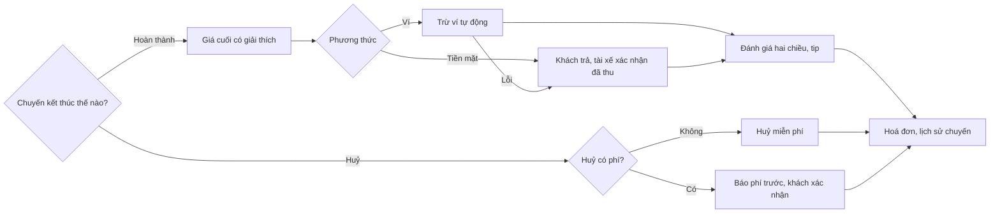

> **Mã:** DE04-TN04-PRD · **Trạng thái:** đã chốt · **Người viết:** Design · **SRS:** [SRS.md](SRS.md)

# PRD Thanh toán, đánh giá và huỷ chuyến (App đặt xe công nghệ)

## 1. Bối cảnh và vấn đề

### 1.1 Bối cảnh

Tính năng này lo hai lối ra của vòng đời chuyến đi (xem [README](../../README.md)): chuyến hoàn thành thì thanh toán và đánh giá; chuyến dừng giữa chừng thì huỷ và có thể có phí huỷ. Đây là chỗ dễ phát sinh tranh chấp nhất giữa khách và tài xế, vì liên quan tới tiền.

### 1.2 Vấn đề

| **Vấn đề** | **Hệ quả** |
| --- | --- |
| Giá cuối khác giá ước tính mà không giải thích | Khách thấy bị tính sai, khiếu nại |
| Tiền mặt không có tiền lẻ, ví bị lỗi lúc thanh toán | Hai bên đứng đợi, cãi nhau |
| Huỷ chuyến không rõ khi nào mất phí | Khách bực khi bị trừ tiền; tài xế bị huỷ sau khi đã chạy tới |
| Đánh giá chỉ một chiều | Tài xế không được bảo vệ trước khách xấu |
| Đánh giá xong không có tác dụng | Khách không đánh giá nữa |
| Không xem lại được chuyến cũ | Không có hoá đơn, không khiếu nại được |

### 1.3 Mục tiêu

- ≥ 98% chuyến hoàn thành được thanh toán ngay khi kết thúc.
- Tỉ lệ khiếu nại về giá ≤ 1% chuyến.
- ≥ 50% chuyến được khách đánh giá.

## 2. Người dùng

| **Nhóm** | **Nhu cầu với tính năng này** |
| --- | --- |
| Khách đi làm | Thanh toán ví tự động, có hoá đơn |
| Khách dùng tiền mặt | Biết chính xác số tiền phải trả |
| Khách đổi ý | Biết trước huỷ có mất phí không |
| Tài xế | Không bị huỷ sau khi đã chạy tới; đánh giá được khách |

## 3. Phạm vi

### 3.1 Trong phạm vi (MVP)

- Phương thức: tiền mặt và ví liên kết (đã liên kết sẵn).
- Giá cuối: giá chốt, cộng phí chờ, tính lại khi lộ trình thay đổi nhiều.
- Thanh toán ví tự động khi kết thúc; ví lỗi thì chuyển tiền mặt.
- Hoá đơn chuyến trong app và qua email.
- Huỷ chuyến: miễn phí, có phí huỷ theo thời điểm; tài xế huỷ khi khách không đến.
- Đánh giá hai chiều: khách đánh giá tài xế, tài xế đánh giá khách; 1–5 sao kèm nhận xét.
- Tiền tip cho tài xế khi thanh toán bằng ví.
- Lịch sử chuyến và báo cáo sự cố một chuyến.

### 3.2 Ngoài phạm vi

- Nạp tiền vào ví, liên kết ví mới (dùng luồng của ví).
- Thẻ tín dụng, chia tiền với người đi cùng.
- Hoàn tiền tự động; khiếu nại do tổng đài xử lý.
- Xuất hoá đơn VAT → phase sau.

## 4. Nguyên tắc sản phẩm

### 4.1 Giá cuối luôn có giải thích

Giá cuối hiện từng dòng: giá chuyến, phí chờ, điều chỉnh do lộ trình. Khác giá ước tính thì nói rõ vì sao.

### 4.2 Huỷ minh bạch

Trước khi khách xác nhận huỷ, app nói rõ có mất phí hay không và bao nhiêu. Không có phí nào hiện ra sau đó.

### 4.3 Thanh toán không làm khách và tài xế phải đứng đợi

Ví thanh toán tự động. Ví lỗi thì báo cả hai phía và chuyển sang tiền mặt ngay.

### 4.4 Đánh giá công bằng hai chiều

Hai bên đánh giá độc lập, không thấy điểm của nhau trước khi gửi. Đánh giá thấp kèm lý do để đội vận hành xử lý.

## 5. Quy tắc nghiệp vụ

| **Quy tắc** | **Giá trị** |
| --- | --- |
| Giá cuối | Giá chốt + phí chờ; lộ trình thực tế dài hơn đề xuất > 20% thì tính lại theo thực tế, ngắn hơn thì giữ giá chốt. Riêng chuyến dừng giữa đường do phía tài xế thì tính theo thực tế, không vượt giá chốt |
| Huỷ miễn phí | Khi đang tìm tài xế; trong 2 phút đầu sau khi có tài xế; khi tài xế đến trễ > 5 phút so với dự kiến |
| Phí huỷ | Sau 2 phút kể từ khi có tài xế: xe máy 10.000 ₫, ô tô 20.000 ₫ |
| Tài xế huỷ vì khách không đến | Sau 10 phút chờ tính phí (sau thời gian chờ miễn phí); khách bị tính phí huỷ và phí chờ |
| Phí huỷ với tiền mặt | Cộng vào chuyến sau của khách; nợ > 50.000 ₫ thì trả bằng ví trong app, hoặc trả tiền mặt cho tài xế ở chuyến kế tiếp |
| Tip | 5.000, 10.000, 20.000 ₫ hoặc tự nhập ≤ 100.000 ₫; chỉ với ví |
| Đánh giá | 1–5 sao; ≤ 3 sao bắt buộc chọn lý do; nhận xét ≤ 200 ký tự; trong 24 giờ sau chuyến |
| Báo cáo sự cố | Trong 7 ngày sau chuyến |

- Các giá trị trên là **cấu hình theo thành phố**, không cố định trong code.

## 6. Luồng trải nghiệm

| **Bước** | **Giai đoạn** | **Trải nghiệm khách** | **Trải nghiệm tài xế** |
| --- | --- | --- | --- |
| 1 | Kết thúc | Màn giá cuối với từng dòng | Màn thu tiền: số tiền, phương thức |
| 2 | Thanh toán | Ví tự trừ; tiền mặt hiện số tiền cần trả | Ví: "Đã thanh toán"; tiền mặt: bấm "Đã thu tiền" |
| 3 | Đánh giá | Chọn sao, lý do, nhận xét, tip | Chọn sao, lý do |
| 4 | Sau chuyến | Hoá đơn trong lịch sử và email | Thu nhập chuyến cộng vào ngày |
| 5 | Huỷ | Thấy phí (nếu có) trước khi xác nhận | Được báo khi khách huỷ; huỷ được khi khách không đến |

## 7. Use Cases, User Stories và Acceptance Criteria

### UC1. Thanh toán

#### US1.1 Chọn phương thức trước khi đặt

User Story: Là khách, tôi muốn chọn phương thức thanh toán trước khi đặt để không lúng túng lúc kết thúc chuyến.

AC01: Mặc định là phương thức đã dùng ở chuyến trước; đổi được ở màn chọn loại xe.

AC02: Ví liên kết hiện số dư; không đủ số dư cho giá ước tính → gợi ý tiền mặt.

#### US1.2 Thanh toán khi kết thúc

User Story: Là khách, tôi muốn biết chính xác mình trả bao nhiêu và vì sao.

AC01: Màn giá cuối hiện: giá chuyến, phí chờ, điều chỉnh lộ trình, phí huỷ chuyến trước (nếu có), tổng.

AC02: Giá cuối khác giá ước tính → một dòng giải thích lý do.

AC03: Ví → tự trừ, hiện "Đã thanh toán"; tài xế cũng thấy ngay.

AC04: Ví lỗi → báo cả hai phía, chuyển tiền mặt, tài xế thu tiền.

AC05: Tiền mặt → tài xế bấm "Đã thu tiền"; khách thấy "Đã thanh toán".

#### US1.3 Hoá đơn và lịch sử

User Story: Là khách, tôi muốn xem lịch sử chuyến và hoá đơn để đối chiếu, khiếu nại khi có vấn đề.

AC01: Lịch sử chuyến liệt kê chuyến hoàn thành và đã huỷ, mới nhất trước.

AC02: Chi tiết chuyến có lộ trình, thời gian, tài xế, biển số, từng dòng giá, phương thức thanh toán.

AC03: Hoá đơn gửi email nếu khách có email.

AC04: "Đặt lại" tạo chuyến mới với cùng điểm đón, điểm đến.

### UC2. Huỷ chuyến

#### US2.1 Khách huỷ

User Story: Là khách, tôi muốn biết trước huỷ có mất phí không để quyết định.

AC01: Huỷ lúc đang tìm tài xế → không phí, không hỏi lý do.

AC02: Huỷ khi đã có tài xế → hỏi lý do và nói rõ phí (0 ₫ hoặc số tiền) trước khi xác nhận.

AC03: Tài xế đến trễ > 5 phút so với dự kiến → huỷ miễn phí, kèm lý do "Tài xế đến trễ".

AC04: Không huỷ được khi đã bắt đầu chuyến.

#### US2.2 Tài xế huỷ vì khách không đến

User Story: Là tài xế, tôi muốn huỷ chuyến khi khách không đến và được bù để không mất công chờ.

AC01: Sau 10 phút chờ tính phí, tài xế có nút "Khách không đến"; khách bị tính phí huỷ, phí chờ và được báo.

AC02: Tài xế huỷ vì lý do khác trước khi bắt đầu chuyến, kể cả khi đã đến điểm đón (TN02) → khách không bị phí, hệ thống tìm tài xế khác.

### UC3. Đánh giá

#### US3.1 Khách đánh giá tài xế

User Story: Là khách, tôi muốn đánh giá tài xế sau chuyến để góp phần giữ chất lượng dịch vụ.

AC01: Màn đánh giá hiện sau thanh toán; bỏ qua được và đánh giá lại trong 24 giờ từ lịch sử.

AC02: ≤ 3 sao bắt buộc chọn ít nhất 1 lý do (ví dụ "Lái xe ẩu", "Thái độ").

AC03: 5 sao hiện lời khen gợi ý và tip (khi dùng ví).

AC04: Đánh giá thấp liên quan an toàn tạo yêu cầu cho đội an toàn.

#### US3.2 Tài xế đánh giá khách

User Story: Là tài xế, tôi muốn đánh giá khách sau chuyến để cộng đồng đi lại tốt hơn.

AC01: Tài xế đánh giá khách sau khi thu tiền; lý do khi ≤ 3 sao.

AC02: Hai bên không thấy điểm cụ thể bên kia cho mình; chỉ thấy điểm trung bình.

### UC4. Báo cáo sự cố

AC01: Từ chi tiết chuyến trong 7 ngày, chọn loại sự cố (sai giá, quên đồ, an toàn, khác) và mô tả.

AC02: Gửi xong có mã yêu cầu và thời gian phản hồi dự kiến.

## 8. Chỉ số theo dõi

| **Chỉ số** | **Định nghĩa** | **Mục tiêu MVP** |
| --- | --- | --- |
| Tỉ lệ thanh toán ngay | Chuyến thanh toán xong trong 2 phút sau kết thúc / chuyến hoàn thành | ≥ 98% |
| Tỉ lệ ví lỗi | Thanh toán ví lỗi / thanh toán ví | ≤ 2% |
| Tỉ lệ khiếu nại giá | Báo cáo sai giá / chuyến hoàn thành | ≤ 1% |
| Tỉ lệ khách huỷ có phí | Huỷ có phí / tổng huỷ của khách | Theo dõi |
| Tỉ lệ đánh giá | Chuyến được khách đánh giá / chuyến hoàn thành | ≥ 50% |
| Điểm trung bình | Trung bình sao khách cho tài xế | Theo dõi |
| Tỉ lệ tip | Chuyến có tip / chuyến dùng ví | Theo dõi |

## 9. Phụ thuộc và rủi ro

| **Mục** | **Mô tả** | **Hướng xử lý** |
| --- | --- | --- |
| Đối tác ví | Lỗi, chậm phản hồi | Timeout rõ ràng, chuyển tiền mặt; đối soát cuối ngày |
| Trừ tiền hai lần | Gửi lại yêu cầu thanh toán | Idempotency key theo chuyến |
| Phí huỷ gây tranh cãi | Khách không đồng ý phí | Luôn báo trước; khiếu nại qua báo cáo sự cố |
| Thu phí huỷ tiền mặt | Không thu được ngay | Cộng vào chuyến sau |
| Đánh giá trả đũa | Bên này chấm thấp vì bị chấm thấp | Ẩn điểm từng chuyến; chỉ hiện trung bình |

## 10. Câu hỏi mở

> Mọi câu hỏi dưới đây đã được PO chốt ngày 13/11/2026; quyết định ghi sau mỗi câu và đã cập nhật vào SRS.

- Phí huỷ tiền mặt có giới hạn số chuyến cộng dồn không? → **Đã chốt:** Giới hạn theo số tiền, không theo số chuyến: nợ > 50.000 ₫ phải trả trước khi đặt chuyến mới (SRS BR-38).
- Có cho khách sửa đánh giá sau khi gửi? → **Đã chốt:** Không. Mỗi bên đánh giá 1 lần (SRS BR-40).
- Ngưỡng lộ trình dài hơn 20% có hợp lý không? → **Đã chốt:** Giữ 20% (SRS BR-33).
- Tip có áp dụng cho tiền mặt (khách đưa thêm, tài xế ghi nhận) không? → **Đã chốt:** Không. Tip chỉ qua ví (SRS BR-39).
