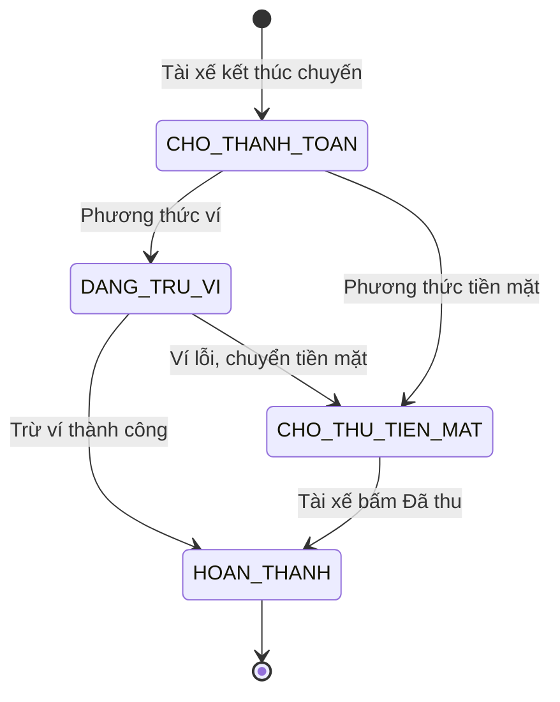
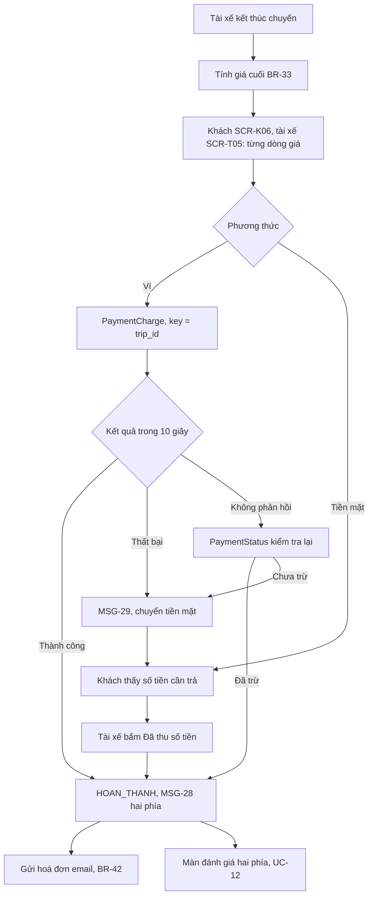
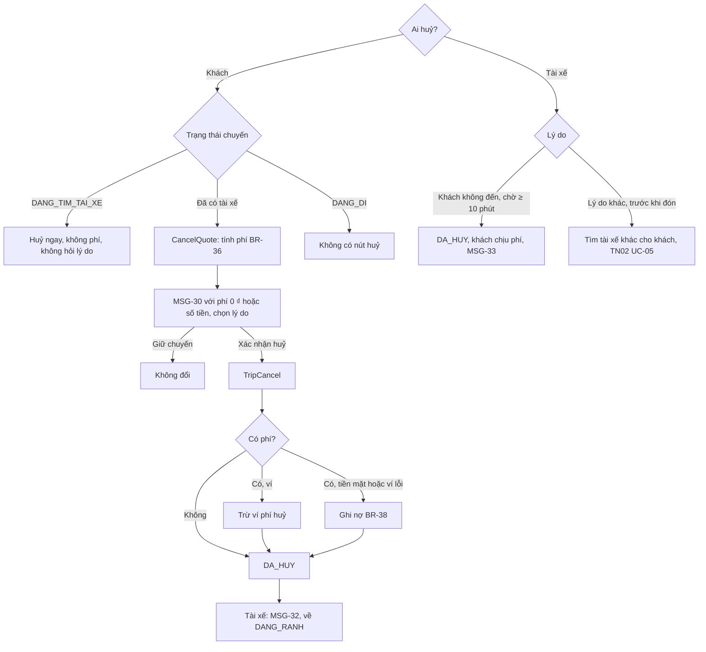
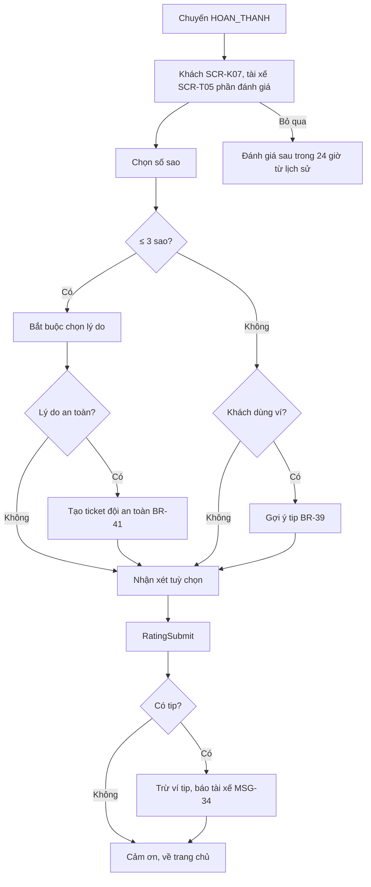
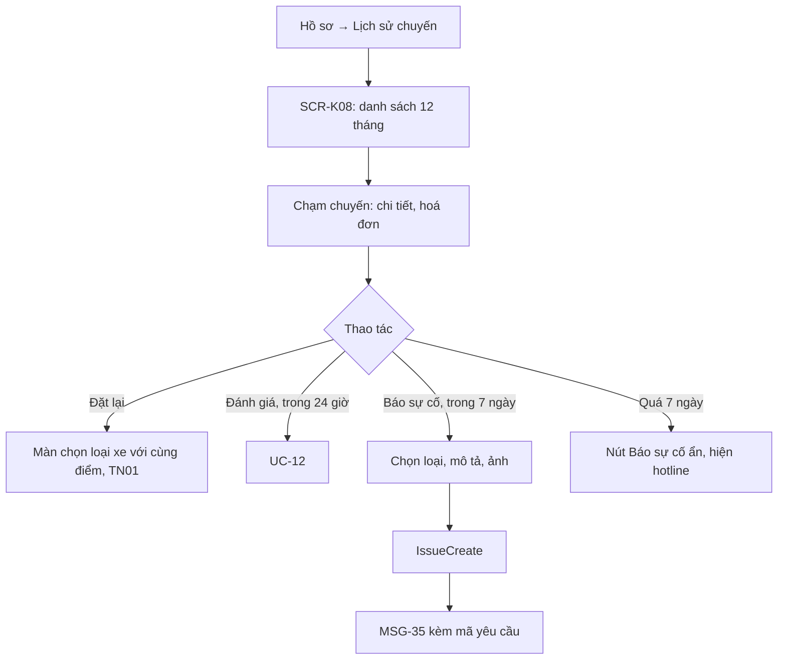
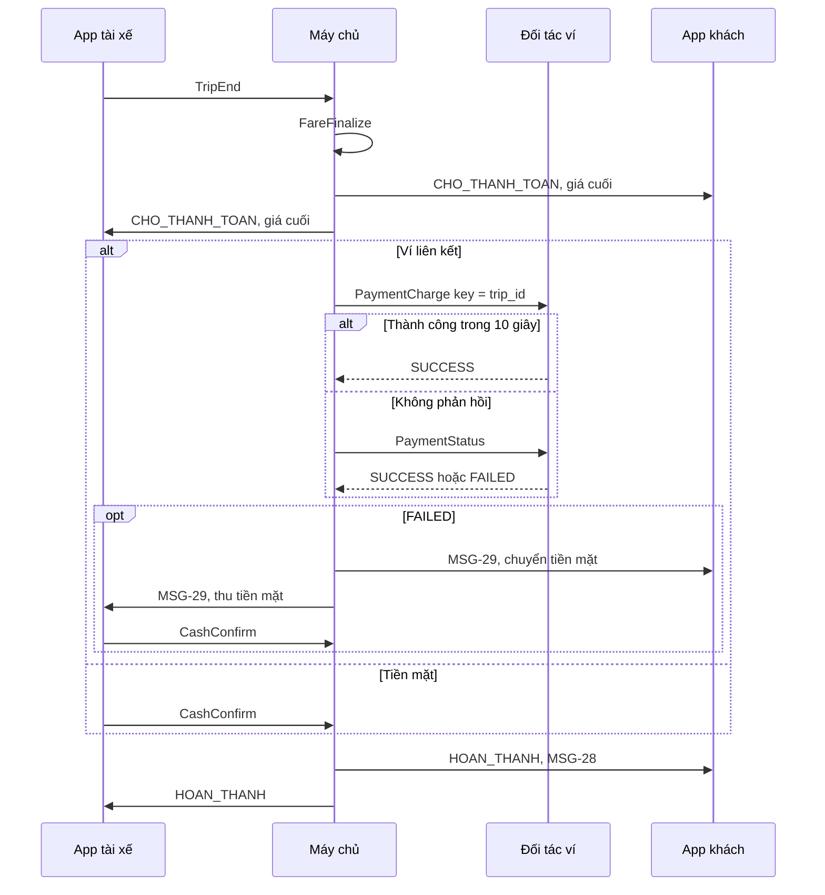

> **Mã:** DE04-TN04-SRS · **Trạng thái:** nháp · **Người viết:** Design (mock) · **PRD:** [PRD.md](PRD.md)

# UC-DE04-04 - Thanh toán, đánh giá và huỷ chuyến

> **Bản mock.** Giá trị `[giả định]` cần BA xác nhận. SRS này mô tả chuyến từ `CHO_THANH_TOAN` tới `HOAN_THANH`, mọi đường vào `DA_HUY`, lịch sử chuyến và báo cáo sự cố.

## 1. Tổng quan

| **Mục** | **Nội dung** |
| --- | --- |
| Mục tiêu | Tính giá cuối minh bạch, thanh toán tiền mặt hoặc ví, đánh giá hai chiều, huỷ chuyến có quy tắc phí rõ ràng |
| Actor | Khách · Tài xế · App khách · App tài xế · Máy chủ · Đối tác ví |
| Phạm vi | Chọn phương thức; giá cuối; thanh toán; tip; hoá đơn; huỷ của khách và tài xế; phí huỷ; đánh giá; lịch sử; báo cáo sự cố |
| Ngoài phạm vi | Nạp ví, liên kết ví, thẻ tín dụng, hoàn tiền tự động, hoá đơn VAT |
| Nền tảng | App khách, App tài xế iOS / Android `[giả định]` |
| Figma | `[chưa có]` |

## 2. User Story

| **ID** | **As a** | **I want** | **So that** |
| --- | --- | --- | --- |
| US-18 | Khách | Thấy giá cuối có giải thích | Tin là mình trả đúng |
| US-19 | Khách | Thanh toán ví tự động | Không phải đứng đợi |
| US-20 | Tài xế | Xác nhận đã thu tiền mặt | Chuyến được ghi nhận đúng |
| US-21 | Khách | Biết trước phí huỷ | Quyết định huỷ hay không |
| US-22 | Tài xế | Huỷ khi khách không đến và được bù | Không mất công chờ |
| US-23 | Khách, tài xế | Đánh giá bên kia | Cộng đồng đi lại tốt hơn |
| US-24 | Khách | Xem lịch sử, hoá đơn, báo sự cố | Khiếu nại khi có vấn đề |

## 3. Business Rules

| **Mã** | **Quy tắc** |
| --- | --- |
| BR-32 | **Phương thức**: `TIEN_MAT`, `VI_LIEN_KET`. Mặc định là phương thức của chuyến trước. Ví không đủ số dư cho giá ước tính → MSG-27 gợi ý tiền mặt |
| BR-33 | **Giá cuối** = giá chốt (TN01) + phí chờ (BR-25) + phí huỷ còn nợ của khách (BR-38). Lộ trình thực tế dài hơn lộ trình đề xuất > 20% → giá chuyến tính lại theo km, phút thực tế; ngắn hơn → giữ giá chốt `[giả định]` |
| BR-34 | **Thanh toán ví**: tự gọi trừ ví khi chuyến sang `CHO_THANH_TOAN`, idempotency key = trip_id. Thất bại hoặc không phản hồi trong 10 giây → kiểm tra lại trạng thái giao dịch; vẫn chưa thành công → chuyển `TIEN_MAT`, báo hai phía (MSG-29) |
| BR-35 | **Thanh toán tiền mặt**: tài xế bấm "Đã thu {số tiền}" → chuyến `HOAN_THANH` |
| BR-36 | **Huỷ của khách** – miễn phí khi: chuyến `DANG_TIM_TAI_XE`; trong 2 phút đầu kể từ lúc có tài xế; hoặc tài xế trễ > 5 phút so với thời gian đến dự kiến lúc nhận. Ngoài các trường hợp trên: phí huỷ xe máy 10.000 ₫, ô tô 20.000 ₫. Không huỷ được từ `DANG_DI` `[giả định]` |
| BR-37 | **Huỷ của tài xế**: trước khi đón (TN02, BR-19) → khách không phí. "Khách không đến" chỉ bật sau 10 phút chờ (BR-25) → chuyến `DA_HUY`, khách chịu phí huỷ, tài xế nhận phí huỷ |
| BR-38 | **Thu phí huỷ**: ví → trừ ngay; tiền mặt hoặc ví lỗi → ghi nợ, cộng vào giá cuối chuyến kế tiếp (một khoản nợ mỗi lần; nợ > 50.000 ₫ thì phải thanh toán trước khi đặt chuyến mới) `[giả định]` |
| BR-39 | **Tip**: chỉ khi thanh toán ví; 5.000 / 10.000 / 20.000 ₫ hoặc tự nhập ≤ 100.000 ₫; trừ ví riêng, 100% cho tài xế; chỉ trong lúc đánh giá |
| BR-40 | **Đánh giá**: 1–5 sao; ≤ 3 sao bắt buộc ≥ 1 lý do; nhận xét ≤ 200 ký tự; trong 24 giờ sau chuyến; mỗi bên đánh giá 1 lần, không sửa. Điểm hiển thị = trung bình 100 chuyến gần nhất, cần ≥ 5 đánh giá |
| BR-41 | **Đánh giá liên quan an toàn** (lý do "Lái xe nguy hiểm", "Quấy rối") → tự tạo ticket đội an toàn |
| BR-42 | **Lịch sử chuyến**: chuyến `HOAN_THANH`, `DA_HUY`, `KHONG_TIM_DUOC` của 12 tháng gần nhất; hoá đơn gửi email khi `HOAN_THANH` nếu có email |
| BR-43 | **Báo cáo sự cố** trong 7 ngày sau chuyến; loại: Sai giá, Quên đồ, An toàn, Thái độ, Khác; mô tả ≤ 500 ký tự; tối đa 3 ảnh |

## 4. Trạng thái

### 4.1 Thanh toán của chuyến

### 4.2 Huỷ theo thời điểm

| **Trạng thái chuyến** | **Ai huỷ được** | **Phí** |
| --- | --- | --- |
| `DANG_TIM_TAI_XE` | Khách | Không |
| `TAI_XE_DANG_DEN`, ≤ 2 phút từ lúc có tài xế | Khách; tài xế | Không |
| `TAI_XE_DANG_DEN`, > 2 phút | Khách (có phí, trừ khi tài xế trễ > 5 phút); tài xế (khách không phí) | Khách huỷ: phí huỷ |
| `TAI_XE_DA_DEN`, `DANG_CHO_KHACH` < 10 phút | Khách (có phí); tài xế (khách không phí) | Khách huỷ: phí huỷ |
| `DANG_CHO_KHACH` ≥ 10 phút | Khách (có phí); tài xế chọn "Khách không đến" (khách chịu phí) | Phí huỷ |
| `DANG_DI` trở đi | Không ai huỷ được | – |

## 5. Use Case

### UC-10 Thanh toán khi kết thúc chuyến

| **Mục** | **Nội dung** |
| --- | --- |
| Tiền điều kiện | Chuyến `CHO_THANH_TOAN` |
| Hậu điều kiện thành công | Chuyến `HOAN_THANH`; hoá đơn tạo; thu nhập tài xế ghi nhận |
| Hậu điều kiện thất bại | Chuyến ở `CHO_THU_TIEN_MAT`; tổng đài theo dõi chuyến chưa thanh toán sau 30 phút |

**Luồng chính**

| **Bước** | **Actor** | **Mô tả** |
| --- | --- | --- |
| 1 | Máy chủ | Chuyến `CHO_THANH_TOAN`; tính giá cuối (BR-33) |
| 2 | Hai app | Khách mở **SCR-K06**, tài xế mở **SCR-T05** với cùng giá cuối và từng dòng |
| 3 | Máy chủ | Ví → gọi \[PaymentCharge\] (BR-34) |
| 4 | Máy chủ | Thành công → chuyến `HOAN_THANH`; đẩy MSG-28 cho hai phía |
| 5 | Hai app | Chuyển sang đánh giá (UC-12) |

**Luồng thay thế**

| **Mã** | **Điều kiện** | **Xử lý** |
| --- | --- | --- |
| A1 | Tiền mặt | **SCR-K06** hiện "Vui lòng trả tài xế {số tiền}"; tài xế bấm "Đã thu" (BR-35) |
| A2 | Ví lỗi | MSG-29; chuyển A1 |
| A3 | Ví không phản hồi | Kiểm tra lại \[PaymentStatus\] trước khi kết luận |
| A4 | Giá cuối khác giá chốt | Dòng giải thích: "Lộ trình dài hơn dự kiến {x} km" hoặc "Phí chờ {n} phút" |
| A5 | Có nợ phí huỷ | Dòng "Phí huỷ chuyến {ngày}" cộng vào tổng |

**Luồng lỗi**

| **Mã** | **Điều kiện** | **Xử lý** |
| --- | --- | --- |
| E1 | Tài xế bấm "Đã thu" khi mất mạng | Xếp hàng gửi lại; app tài xế hiện "Đang chờ kết nối" |
| E2 | Sau 30 phút chưa `HOAN_THANH` | Tạo ticket cho tổng đài |
| E3 | Khách không trả hoặc trả thiếu tiền mặt | Tài xế chọn "Khách chưa trả đủ" ở **SCR-T05**, nhập số đã thu; chuyến `HOAN_THANH`, phần thiếu ghi nợ cho khách như BR-38, tạo ticket cho tổng đài |

### UC-11 Huỷ chuyến

| **Mục** | **Nội dung** |
| --- | --- |
| Tiền điều kiện | Chuyến trước `DANG_DI` |
| Hậu điều kiện thành công | Chuyến `DA_HUY` với người huỷ, lý do, phí (nếu có) |
| Hậu điều kiện thất bại | Chuyến giữ trạng thái cũ |

**Luồng chính (khách huỷ khi đã có tài xế)**

| **Bước** | **Actor** | **Mô tả** |
| --- | --- | --- |
| 1 | Khách | Bấm "Huỷ chuyến" ở **SCR-K05** |
| 2 | App khách | Gọi \[CancelQuote\]; hiện MSG-30 với phí theo BR-36 và danh sách lý do |
| 3 | Khách | Chọn lý do, bấm "Xác nhận huỷ" |
| 4 | Máy chủ | \[TripCancel\]; thu phí theo BR-38; chuyến `DA_HUY` |
| 5 | Hai app | Khách về **SCR-K01** kèm MSG-31; tài xế nhận MSG-32, về **SCR-T01** |

**Luồng thay thế**

| **Mã** | **Điều kiện** | **Xử lý** |
| --- | --- | --- |
| A1 | Huỷ khi đang tìm | Không hỏi lý do, không phí |
| A2 | Tài xế trễ > 5 phút | Phí 0 ₫, lý do mặc định "Tài xế đến trễ" |
| A3 | Tài xế chọn "Khách không đến" | BR-37; khách nhận MSG-33 |
| A4 | Trạng thái đổi giữa lúc báo phí và lúc xác nhận | Máy chủ tính lại; phí khác → hiện lại MSG-30 |

### UC-12 Đánh giá hai chiều

| **Mục** | **Nội dung** |
| --- | --- |
| Tiền điều kiện | Chuyến `HOAN_THANH`, trong 24 giờ |
| Hậu điều kiện | Đánh giá được lưu; điểm trung bình cập nhật; tip trừ ví nếu có |

**Luồng chính**

| **Bước** | **Actor** | **Mô tả** |
| --- | --- | --- |
| 1 | Hệ thống | Chuyến `HOAN_THANH`: khách thấy **SCR-K07**, tài xế thấy phần đánh giá ở **SCR-T05** |
| 2 | Khách hoặc tài xế | Chọn số sao |
| 3 | Khách hoặc tài xế | Thêm nhận xét (tuỳ chọn), bấm Gửi |
| 4 | Hệ thống | Gọi \[RatingSubmit\]; cập nhật điểm trung bình |
| 5 | Hệ thống | Cảm ơn, về trang chủ |

**Luồng thay thế**

| **Mã** | **Điều kiện** | **Xử lý** |
| --- | --- | --- |
| A1 | ≤ 3 sao | Bắt buộc chọn ít nhất 1 lý do; lý do về an toàn → tạo ticket cho đội an toàn (BR-41) |
| A2 | Khách chấm 5 sao và dùng ví | Gợi ý tip (BR-39); có tip → trừ ví, tài xế nhận MSG-34 |
| A3 | Bỏ qua | Đánh giá lại được trong 24 giờ từ lịch sử chuyến |

**Luồng lỗi**

| **Mã** | **Điều kiện** | **Xử lý** |
| --- | --- | --- |
| E1 | Gửi đánh giá thất bại | Giữ nội dung đã chọn, cho thử lại |
| E2 | Trừ ví tip thất bại | Đánh giá vẫn được lưu; báo tip chưa thực hiện được |

### UC-13 Lịch sử chuyến và báo cáo sự cố

| **Mục** | **Nội dung** |
| --- | --- |
| Tiền điều kiện | Có ít nhất 1 chuyến |
| Hậu điều kiện | Khách xem được hoá đơn; sự cố có mã yêu cầu |

**Luồng chính**

| **Bước** | **Actor** | **Mô tả** |
| --- | --- | --- |
| 1 | Khách | Hồ sơ → Lịch sử chuyến |
| 2 | Hệ thống | **SCR-K08**: danh sách chuyến 12 tháng, mới nhất trước |
| 3 | Khách | Chạm một chuyến |
| 4 | Hệ thống | Hiện chi tiết và hoá đơn |
| 5 | Khách | Chọn Báo sự cố (trong 7 ngày): chọn loại, mô tả, ảnh |
| 6 | Hệ thống | Gọi \[IssueCreate\]; MSG-35 kèm mã yêu cầu |

**Luồng thay thế**

| **Mã** | **Điều kiện** | **Xử lý** |
| --- | --- | --- |
| A1 | Chọn Đặt lại | Mở màn chọn loại xe với cùng điểm đón, điểm đến (SRS TN01) |
| A2 | Chọn Đánh giá trong 24 giờ | UC-12 |
| A3 | Chuyến quá 7 ngày | Ẩn nút Báo sự cố, hiện hotline |

**Luồng lỗi**

| **Mã** | **Điều kiện** | **Xử lý** |
| --- | --- | --- |
| E1 | Gửi báo cáo thất bại | Giữ nội dung đã nhập, cho thử lại |

## 6. Điểm vào

| **Điểm vào** | **Dẫn tới** | **Ghi chú** |
| --- | --- | --- |
| Chọn phương thức ở **SCR-K03** | Bảng chọn phương thức | BR-32 |
| Chuyến sang `CHO_THANH_TOAN` | UC-10, **SCR-K06**, **SCR-T05** | Tự động |
| "Huỷ chuyến" ở **SCR-K04**, **SCR-K05** | UC-11 | |
| "Khách không đến" ở **SCR-T03** | UC-11 (A3) | Sau 10 phút chờ |
| Sau thanh toán | UC-12 | |
| Hồ sơ → Lịch sử chuyến | UC-13, **SCR-K08** | |
| Thông báo "Bạn chưa đánh giá chuyến" | UC-12 | Gửi 1 lần sau 2 giờ `[giả định]` |

## 7. Mô tả màn hình

### SCR-K06 Kết thúc & thanh toán (App khách)

| **#** | **Thành phần** | **Loại** | **Hành vi** |
| --- | --- | --- | --- |
| 1 | Trạng thái | Banner | "Đang thanh toán…" / "Đã thanh toán" / "Vui lòng trả tài xế {số tiền}" |
| 2 | Tổng tiền | Số lớn | Giá cuối |
| 3 | Chi tiết giá | List | Giá chuyến, phí chờ, điều chỉnh lộ trình, phí huỷ trước đó; mỗi dòng có giải thích ngắn |
| 4 | So với giá ước tính | Text phụ | Hiện khi khác: "Ước tính {x} ₫ · {lý do}" |
| 5 | Phương thức | Text | Ví (kèm 4 số cuối) hoặc Tiền mặt |
| 6 | Tiếp tục | Button | Sang **SCR-K07** khi `HOAN_THANH` |

### SCR-K07 Đánh giá tài xế (App khách)

| **#** | **Thành phần** | **Loại** | **Bắt buộc** | **Hành vi** |
| --- | --- | --- | --- | --- |
| 1 | Tài xế | Header | – | Ảnh, tên, biển số |
| 2 | Sao | Rating 1–5 | Có | Chạm chọn |
| 3 | Lý do | Chips chọn nhiều | Khi ≤ 3 sao | Lái xe nguy hiểm, Thái độ, Đến trễ, Xe không sạch, Đi sai đường, Quấy rối, Khác |
| 4 | Lời khen | Chips | Không | Khi 5 sao: Lái xe an toàn, Thân thiện, Xe sạch |
| 5 | Nhận xét | Text | Không | ≤ 200 ký tự |
| 6 | Tip | Chips | Không | Chỉ khi ví (BR-39) |
| 7 | Gửi | Button | – | Disabled khi thiếu sao hoặc thiếu lý do |
| 8 | Bỏ qua | Button text | – | Đánh giá sau trong 24 giờ |

### SCR-K08 Lịch sử chuyến (App khách)

| **#** | **Thành phần** | **Loại** | **Hành vi** |
| --- | --- | --- | --- |
| 1 | Danh sách | List | Ngày giờ, điểm đón → điểm đến, loại xe, giá, trạng thái (Hoàn thành, Đã huỷ, Không tìm được) |
| 2 | Chi tiết chuyến | Màn | Bản đồ lộ trình, tài xế, biển số, từng dòng giá, phương thức, đánh giá đã gửi |
| 3 | Đặt lại | Button | TN01 |
| 4 | Đánh giá | Button | Trong 24 giờ, chưa đánh giá |
| 5 | Báo sự cố | Button | Trong 7 ngày (BR-43) |

### SCR-T05 Thu tiền & đánh giá khách (App tài xế)

| **#** | **Thành phần** | **Loại** | **Hành vi** |
| --- | --- | --- | --- |
| 1 | Số tiền | Số lớn | Giá cuối; ví: "Khách đã thanh toán qua ví"; tiền mặt: "Thu tiền mặt" |
| 2 | Chi tiết giá | List | Như **SCR-K06** |
| 3 | Thu nhập chuyến | Text | Sau chiết khấu |
| 4 | "Đã thu {số tiền}" | Button lớn | Chỉ tiền mặt; BR-35 |
| 5 | Đánh giá khách | Rating + lý do | Sau khi thanh toán xong; lý do khi ≤ 3 sao |
| 6 | Xong | Button | Về **SCR-T01**, trạng thái `DANG_RANH` |

## 8. API

| **API** | **Request chính** | **Response chính** | **Timeout / retry** `[giả định]` |
| --- | --- | --- | --- |
| \[PaymentMethodsGet\] | user_id | Phương thức, số dư ví, mặc định | 5s / 1 lần |
| \[FareFinalize\] | trip_id, lộ trình thực tế, thời gian chờ | Giá cuối, từng dòng, lý do chênh lệch | Máy chủ tự gọi khi \[TripEnd\] |
| \[PaymentCharge\] | trip_id, amount, method, idempotency_key = trip_id | status, transaction_id | 10s / không tự retry, kiểm tra \[PaymentStatus\] |
| \[PaymentStatus\] | trip_id | status giao dịch | 5s / 3 lần |
| \[CashConfirm\] | trip_id, amount | status `HOAN_THANH` | 5s / gửi lại cùng request_id |
| \[CancelQuote\] | trip_id, actor | fee, lý do miễn phí (nếu có) | 3s / 1 lần |
| \[TripCancel\] | trip_id, actor, reason, quoted_fee | status `DA_HUY`, fee thực thu, debt | 5s / gửi lại cùng request_id |
| \[RatingSubmit\] | trip_id, actor, stars, reasons, comment, tip | – | 5s / 2 lần |
| \[TripHistory\] | user_id, cursor | Danh sách chuyến | 5s / 1 lần |
| \[IssueCreate\] | trip_id, type, description, photos | issue_id, sla | 8s / 2 lần |

**Map lỗi → thông báo**

| **Nhóm lỗi** | **Message** |
| --- | --- |
| Ví không đủ số dư | MSG-27 |
| Trừ ví thất bại hoặc không phản hồi | MSG-29 |
| Huỷ khi chuyến đã bắt đầu | MSG-38 |
| Phí huỷ thay đổi giữa lúc báo và lúc xác nhận | Hiện lại MSG-30 với phí mới |
| Còn nợ phí huỷ khi đặt chuyến mới | MSG-36 |
| Mất mạng, lỗi máy chủ khác | Thông báo lỗi chung của app (ngoài bộ MSG của SRS này), cho thử lại |

## 9. Danh sách thông báo

| **ID** | **Nơi hiện** | **Nội dung (VI)** |
| --- | --- | --- |
| MSG-27 | Inline **SCR-K03** | Số dư ví không đủ cho chuyến này. \[Dùng tiền mặt\] \[Nạp ví\] |
| MSG-28 | Toast hai phía | Đã thanh toán {số tiền} ₫ |
| MSG-29 | Popup hai phía | Thanh toán ví chưa thành công. Vui lòng thanh toán {số tiền} ₫ bằng tiền mặt cho tài xế |
| MSG-30 | Popup (khách) | Huỷ chuyến? {Bạn sẽ không mất phí / Phí huỷ: {x} ₫ vì tài xế đã nhận chuyến hơn 2 phút}. \[Giữ chuyến\] \[Xác nhận huỷ\] |
| MSG-31 | Toast (khách) | Đã huỷ chuyến{, phí huỷ {x} ₫ {đã trừ ví / sẽ cộng vào chuyến sau}} |
| MSG-32 | Popup (tài xế) | Khách đã huỷ chuyến{. Bạn nhận {x} ₫ phí huỷ} |
| MSG-33 | Thông báo đẩy (khách) | Tài xế đã chờ 10 phút và huỷ chuyến. Phí huỷ {x} ₫ |
| MSG-34 | Thông báo (tài xế) | Khách đã tip cho bạn {x} ₫ |
| MSG-35 | Toast | Đã gửi báo cáo, mã {issue_id}. Chúng tôi sẽ phản hồi trong {sla} |
| MSG-36 | Popup (khách) | Bạn còn {x} ₫ phí huỷ chưa thanh toán. Vui lòng thanh toán trước khi đặt chuyến mới. \[Thanh toán\] |
| MSG-37 | Thông báo đẩy (khách) | Chuyến của bạn với {tài xế} thế nào? \[Đánh giá\] |
| MSG-38 | Inline | Chuyến đã bắt đầu nên không thể huỷ. Nếu có vấn đề, hãy dùng nút an toàn |

Bản EN: `[chờ bổ sung]`.

## 10. Yêu cầu phi chức năng

| **Mục** | **Yêu cầu** `[giả định]` |
| --- | --- |
| Hiệu năng | Giá cuối hiện ≤ 2 giây sau khi kết thúc chuyến; trừ ví ≤ 10 giây (p95) |
| Toàn vẹn tiền | Không trừ ví hai lần cho một chuyến; mọi khoản phí, tip có bản ghi giao dịch; đối soát với đối tác ví hằng ngày |
| Bảo mật | Không lưu thông tin ví ngoài token của đối tác; hoá đơn chỉ gửi email của chủ tài khoản |
| Log / audit | Mỗi chuyến: giá chốt, giá cuối, từng dòng, phương thức, kết quả thanh toán; mỗi lần huỷ: actor, trạng thái lúc huỷ, phí báo, phí thu |
| Tracking | Phương thức chọn; ví lỗi; chênh lệch giá; huỷ (actor, trạng thái, phí); đánh giá (sao, lý do, có nhận xét, tip); báo sự cố (loại) |
| Accessibility | Từng dòng giá đọc được bằng trình đọc màn hình; sao có nhãn "1 sao … 5 sao"; phí huỷ hiện bằng chữ, không chỉ bằng màu |
